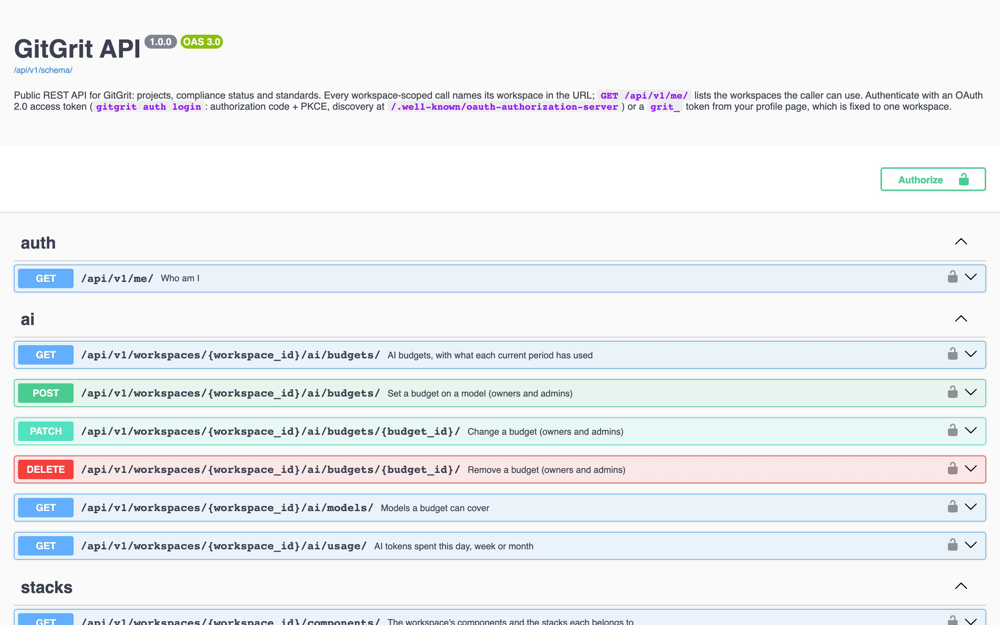
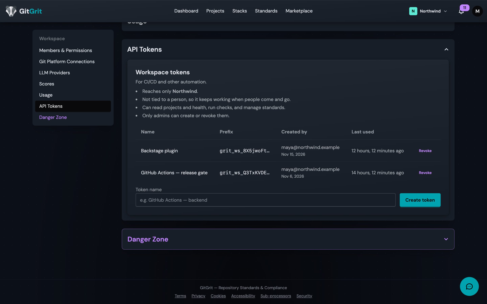
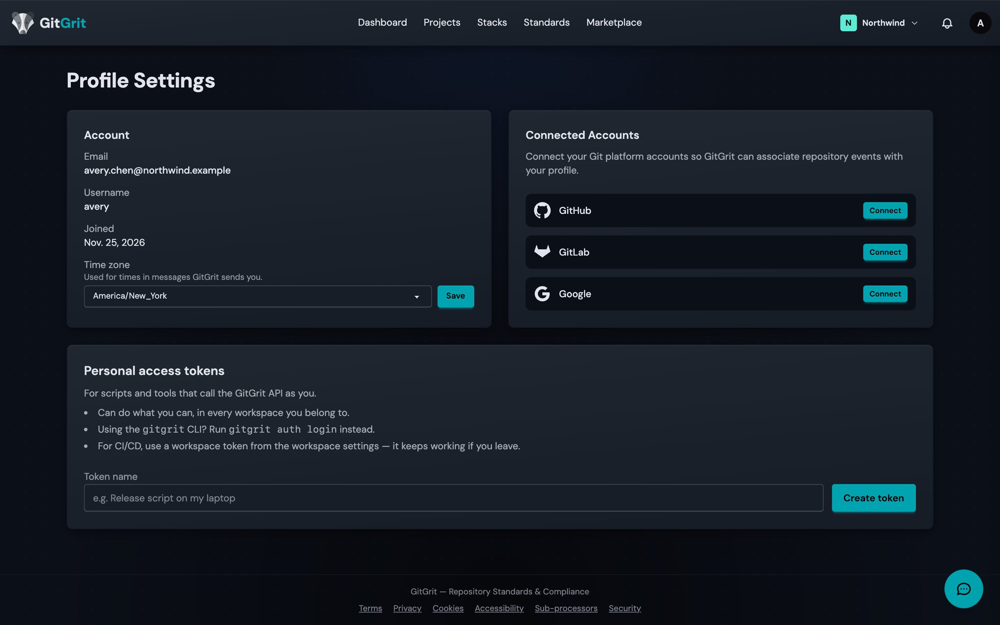

# REST API & Tokens

Everything you do in the web app, you can do over HTTP. The [`gitgrit` CLI](../getting-started/cli.md) is built on the same API.

- **Base URL:** `https://app.gitgrit.dev/api/v1/` (or your own host when [self-hosting](../self-hosting/index.md))
- **Interactive docs:** `/api/v1/docs/`, a Swagger UI where you can try each call
- **OpenAPI 3 spec:** `/api/v1/schema/`, for generating a client

{ .gg-shot loading=lazy }

## Authenticate

Send a token in the `Authorization` header:

```sh
curl -H "Authorization: Bearer $GITGRIT_TOKEN" \
  https://app.gitgrit.dev/api/v1/me/
```

There are two kinds of token:

| | Personal token | Workspace token |
|---|---|---|
| Prefix | `grit_pat_…` | `grit_ws_…` |
| Acts as | you | the workspace |
| Reaches | every workspace you belong to | one workspace |
| Created in | **Profile → Personal access tokens** | **Workspace Settings → API Tokens** (owners and admins) |
| Best for | scripts on your laptop, local tools | CI/CD and other automation |
| When its creator leaves | stops working | keeps working |

{ .gg-shot loading=lazy }

{ .gg-shot loading=lazy }

A new token is shown **once**, right after you create it. Copy it then: GitGrit stores only a hash. Each row shows its prefix, who created it and when it was last used. Revoke a token from its row; anything still using it gets `401` from then on.

!!! tip "In CI, use a workspace token"
    A workspace token isn't tied to a person, so a build doesn't break when someone leaves the team. It can read projects and health, run checks and manage standards, in its own workspace only.

## The workspace is in the URL

Almost every endpoint lives under a workspace:

```
/api/v1/workspaces/{workspace_id}/…
```

`GET /api/v1/me/` returns you and the workspaces you belong to, with their ids.

## Endpoints

Paths below are relative to `/api/v1/workspaces/{workspace_id}/`.

### Projects and health

| Method | Path | What it does |
|---|---|---|
| `GET` | `overview/` | The dashboard in one call: health counts, warning lights, what needs you |
| `GET` `POST` | `projects/` | List projects; add a repository as a project (`root_path` for a [monorepo](../getting-started/monorepos.md) directory) |
| `GET` | `projects/resolve/?repo_full_path=org/repo` | Find a project by its repository path (or `?web_url=`); `&path=` picks the monorepo project that directory is in |
| `GET` `PATCH` `DELETE` | `projects/{project_id}/` | One project; change its lifecycle or owner; remove it |
| `GET` | `projects/{project_id}/status/` | The project's grade and score, and why |
| `GET` | `projects/{project_id}/health/` | Each attached standard's latest result |
| `GET` | `projects/{project_id}/branches/` | Branches, each with its score |
| `GET` `POST` | `projects/{project_id}/commits/` | A branch's commits, each with its score; upload a commit to an [artifact project](../getting-started/artifact-projects.md) |
| `GET` | `projects/{project_id}/commits/{sha}/` | Every check of one commit and what it found |
| `POST` | `projects/{project_id}/checks/` | Run the standards on a commit (what `gitgrit check` calls) |
| `GET` `POST` | `projects/{project_id}/standards/` | Attached standards and their importance; attach more |
| `PATCH` `DELETE` | `projects/{project_id}/standards/{standard_id}/` | Set one standard's importance; detach it |

### Standards and the marketplace

| Method | Path | What it does |
|---|---|---|
| `GET` `POST` | `standards/` | List or create standards |
| `GET` `PATCH` `DELETE` | `standards/{standard_id}/` | Read, edit or archive one |
| `POST` | `standards/{standard_id}/enable/`, `…/disable/` | Turn a standard on or off |
| `POST` | `standards/test/` | Run standard code against its test cases, without saving |
| `GET` | `marketplace/` | Packs and standards, and which are installed |
| `GET` | `marketplace/packs/{slug}/` | A pack's standards |
| `POST` | `marketplace/packs/{slug}/install/` | Install a whole pack |
| `POST` | `marketplace/standards/{slug}/install/`, `…/update/` | Install one standard, or update it to the latest version |

### Stacks

| Method | Path | What it does |
|---|---|---|
| `GET` `POST` | `stacks/` | List or create stacks |
| `GET` `PATCH` `DELETE` | `stacks/{stack_id}/` | Read, rename or delete a stack |
| `POST` | `stacks/{stack_id}/projects/` | Add projects to a stack |
| `DELETE` | `stacks/{stack_id}/projects/{project_id}/` | Remove a project from a stack |
| `POST` | `stacks/{stack_id}/refresh/` | Rebuild the stack's map |

### Connections

| Method | Path | What it does |
|---|---|---|
| `GET` `POST` | `connections/` | List git platform connections; add one with a token |
| `GET` | `connections/{connection_id}/repositories/` | Repositories a connection can reach |

### AI

| Method | Path | What it does |
|---|---|---|
| `GET` `POST` | `llm/providers/` | LLM providers; add one |
| `PATCH` `DELETE` | `llm/providers/{provider_id}/` | Edit or remove a provider |
| `POST` | `llm/providers/{provider_id}/test/` | Check the provider's key works |
| `POST` | `llm/providers/{provider_id}/models/refresh/` | Re-read the models the key can use |
| `GET` | `llm/roles/` | Which model each role (`reasoning`, `code`) uses |
| `PUT` `DELETE` | `llm/roles/{role}/` | Point a role at a model; clear it |
| `GET` | `ai/usage/` | Tokens spent, per provider, model, category and standard |
| `GET` | `ai/models/` | Models you can budget |
| `GET` `POST` | `ai/budgets/` | Budgets; add one |
| `PATCH` `DELETE` | `ai/budgets/{budget_id}/` | Change or remove a budget |

## Scores in responses

A commit, branch or project score is one object. Read `outcome` first:

```json
{
  "outcome": "scored",
  "value": 92,
  "reason": "",
  "display": {"text": "A", "tone": "healthy", "spoken": "A, 92 out of 100"}
}
```

- `outcome`: `checking`, `no_score`, `failed` or `scored`
- `value`: the 0–100 score, only when `scored`
- `reason`: why it failed (`"No Secrets in Code failing"`) or has no score (`"X errored"`)
- `display`: how GitGrit shows it. Use `display.text` and `display.tone` and your screens read like GitGrit's.

See [The score](../getting-started/projects.md#the-score) for how it is calculated.

## Example: a CI gate without the CLI

```sh
# Run the standards on this commit and wait for the result
curl -s -X POST \
  -H "Authorization: Bearer $GITGRIT_WS_TOKEN" \
  -H "Content-Type: application/json" \
  -d "{\"sha\": \"$GITHUB_SHA\", \"branch\": \"$GITHUB_REF_NAME\"}" \
  "https://app.gitgrit.dev/api/v1/workspaces/$WS/projects/$PROJECT/checks/"
```

`gitgrit check --wait` does this, then polls the commit until every standard has a result, and exits non-zero when a Required standard fails. See [Command Line](../getting-started/cli.md#in-ci).
