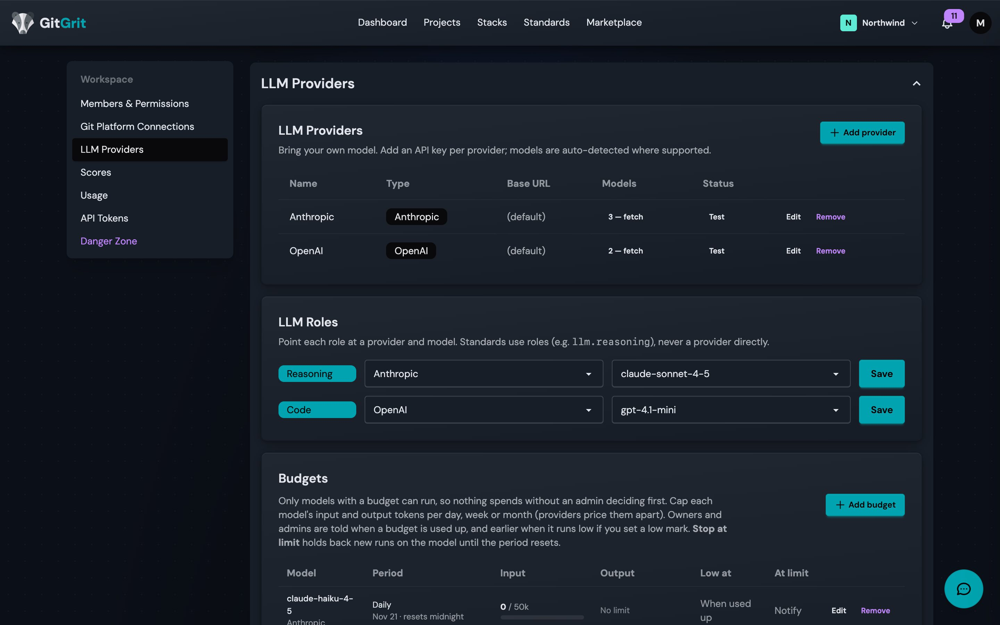
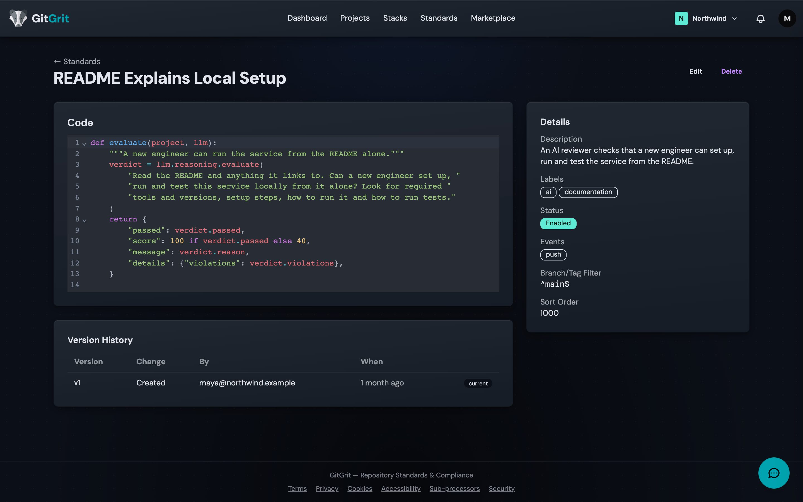
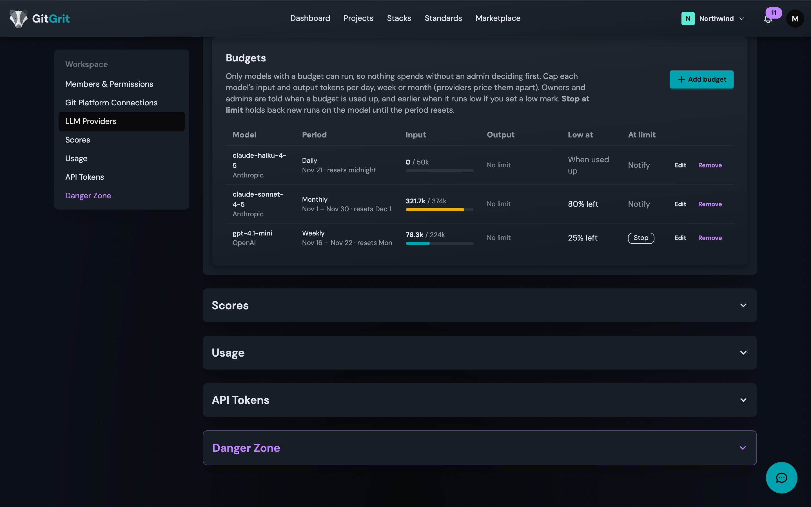
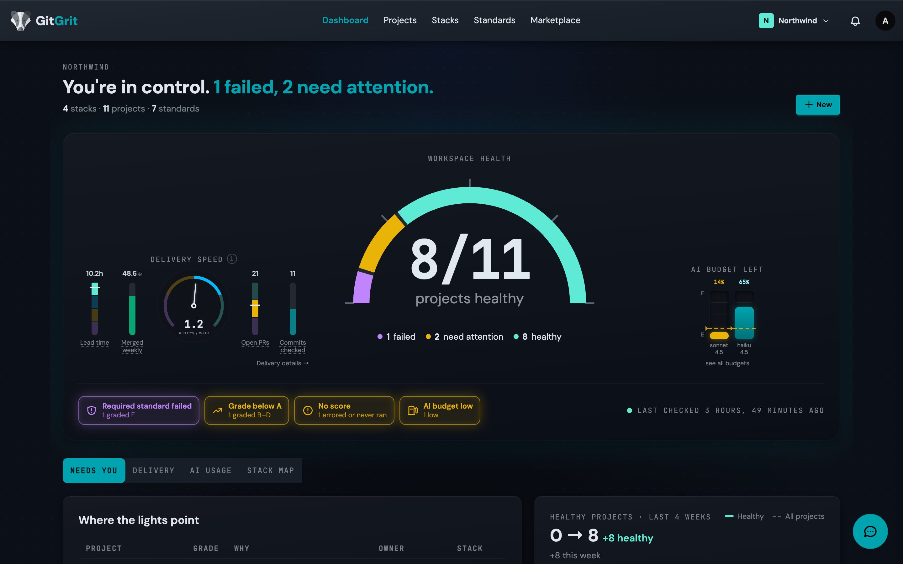
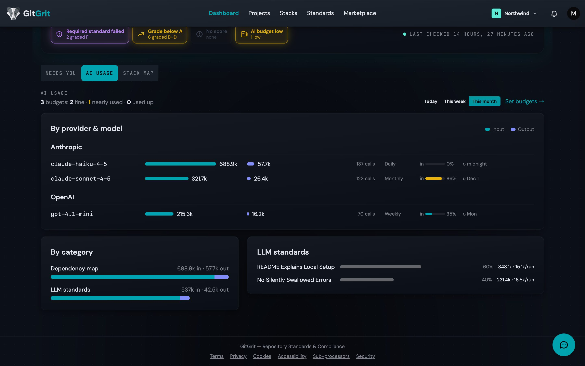

# AI Standards & Budgets

Some rules can't be checked by reading a file name: *"a new engineer can run this service from the README"*, *"handlers never swallow errors"*. GitGrit can hand those to an AI model. You bring the model, GitGrit runs it inside the sandbox, and you decide how much it may spend.

AI is used for two things:

- **LLM standards**: standards whose `evaluate` asks a model for a verdict
- **The dependency map**: inferring each project's dependencies for the [stack map](stacks.md#the-stack-map)

<video class="gg-video" controls muted playsinline preload="metadata" poster="../../images/app/settings-llm.jpg" aria-label="LLM providers, roles and budgets in settings, then AI usage on the dashboard">
  <source src="../../videos/ai.webm" type="video/webm">
</video>

## Providers and roles

In **Workspace Settings → LLM Providers**, owners and admins add a provider with **Add provider**: pick its type, paste an API key, and GitGrit finds the models the key can use.

{ .gg-shot loading=lazy }

Supported providers: **Anthropic**, **OpenAI**, **Azure OpenAI**, **AWS Bedrock**, **Google Vertex AI**, **Google Gemini**, **Mistral**, **Ollama** and any **LiteLLM proxy**. Give a **Base URL** for a self-hosted or proxied endpoint. Keys are encrypted at rest and only reach the sandbox for the run that needs them.

Standards never name a provider. They use a **role**, and each role points at one provider and model:

| Role | Used for |
|---|---|
| **Reasoning** | judgement calls: reading docs, weighing evidence. Also builds the dependency map. |
| **Code** | reading and reviewing source code |

Swap the model behind a role and every standard that uses it follows, with no code change.

## Writing an LLM standard

Add an `llm` parameter to `evaluate` and ask a role for a verdict:

```python
def evaluate(project, llm):
    """A new engineer can run the service from the README alone."""
    verdict = llm.reasoning.evaluate(
        "Read the README and anything it links to. Can a new engineer set up, "
        "run and test this service locally from it alone? Look for required "
        "tools and versions, setup steps, how to run it and how to run tests."
    )
    return {
        "passed": verdict.passed,
        "score": 100 if verdict.passed else 40,
        "message": verdict.reason,
        "details": {"violations": verdict.violations},
    }
```

{ .gg-shot loading=lazy }

`llm.reasoning.evaluate(instructions)` runs an **agentic loop**: the model gets tools to list the repository's files and read them, decides for itself what to look at, and returns a structured verdict:

| Field | Type | Meaning |
|---|---|---|
| `passed` | `bool` | whether the repository meets the instructions |
| `reason` | `str` | one or two sentences on why |
| `violations` | `list[str]` | each specific problem it found |

Use `llm.code` the same way for code review. To get back more than a pass/fail, pass your own Pydantic model as `response_model=`.

Guardrails keep a confused model from running up a bill: at most 12 model round-trips and 20 tool calls per run, and large files are read in pages. The model never sees your Git token: it only sees tool results.

Every run logs what the model did (the role and model, each file it read, the tokens it spent, its verdict) on the run's page, so a surprising failure can be explained. Its tokens are counted against the model's [budget](#budgets) and shown under [AI usage](#ai-usage).

## Budgets

**Only models with a budget can run.** Nothing spends tokens until an owner or admin decides how much it may. Set budgets in **Workspace Settings → LLM Providers → Budgets**:

{ .gg-shot loading=lazy }

| Setting | |
|---|---|
| **Model** | budgets are per model, since providers price models apart |
| **Period** | **day**, **week** or **month**; the budget resets at the start of each |
| **Input** / **Output** | token limits, either or both |
| **Low at** | optional: warn when this much of the budget is left (for example 20%) |
| **At limit** | **Notify** owners and admins, or **Stop**: hold back new runs on the model until the period resets |

Each row shows what's been used this period, as a bar, and when it resets.

When a budget runs low or is used up, owners and admins get a [notification](notifications.md), and the dashboard's **AI budget low** light comes on. The **AI budget left** gauge shows every budgeted model's tank at a glance:

{ .gg-shot loading=lazy }

A run that a budget holds back (or a model with no budget) errors with a message that says so, and its commit has no score until it runs.

To spend less, run AI standards **on a schedule** instead of on every push: once a day on the default branch, with their latest result still in the project score ([Scheduled Standards](schedules.md)).

## AI usage

The dashboard's **AI usage** tab shows the tokens spent today, this week or this month:

{ .gg-shot loading=lazy }

- **By provider & model**: input and output tokens and calls per model, beside its budget
- **By category**: **Dependency map** vs **LLM standards**
- **LLM standards**: each AI standard's share, so one that spends far more than the others stands out

## From the terminal

```sh
gitgrit llm provider add --type anthropic --key-stdin < key.txt
gitgrit llm provider list
gitgrit llm role set reasoning claude-sonnet-4-5
gitgrit llm role set code gpt-4.1-mini --provider OpenAI

gitgrit ai models                                  # models you can budget
gitgrit ai budget set claude-sonnet-4-5 --per month --input 20M --output 2M --low-at 20
gitgrit ai budget list
gitgrit ai usage --period week
```

The [REST API](../api/rest.md#ai) has the same under `llm/` and `ai/`.
