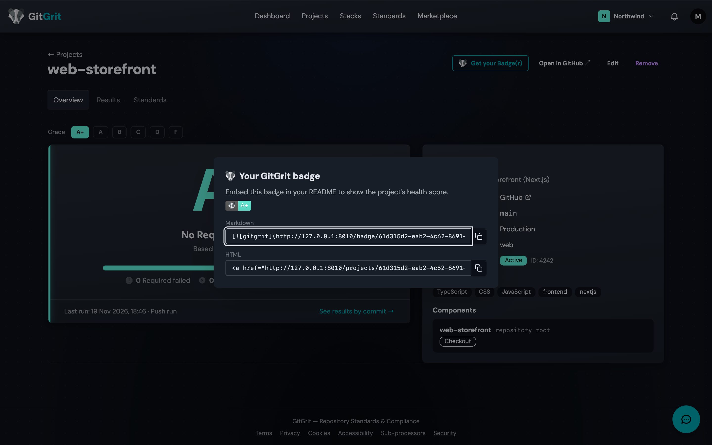

# Compliance Badges

Embed a live compliance badge in your repository README to show your GitGrit compliance score.

## How it works

Each project has a public badge endpoint that returns an SVG image:

```
https://app.gitgrit.dev/badge/<project-id>.svg
```

The badge shows your project's [score](../getting-started/projects.md#the-score) (its newest fully checked commit on the default branch) as a [letter](../getting-started/projects.md#letters), in the letter's colour:

- **A+ / A** — green: healthy
- **B / C** — yellow: needs attention
- **D** — orange: needs attention
- **F** — red: a Required standard failed
- **—** — gray: no score yet

## Adding a badge

1. Open the project in GitGrit.
2. Click **Get your Badge** at the top.
3. Copy the Markdown or HTML snippet.
4. Paste it in your repository's README.

{ .gg-shot loading=lazy }

### Markdown

```markdown
[](https://app.gitgrit.dev/projects/<project-id>/)
```

### HTML

```html
<a href="https://app.gitgrit.dev/projects/<project-id>/">
  .svg" alt="gitgrit">
</a>
```

## Caching

Badges are cached for 5 minutes. After a standard evaluation updates the score, the badge will reflect the new score within 5 minutes.
