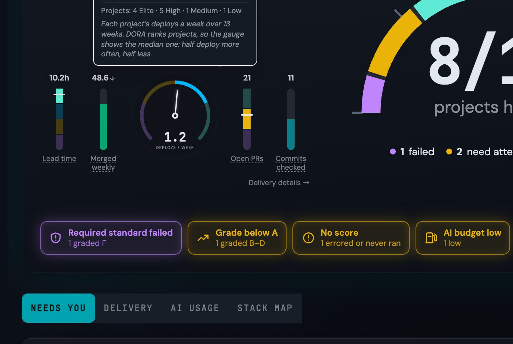
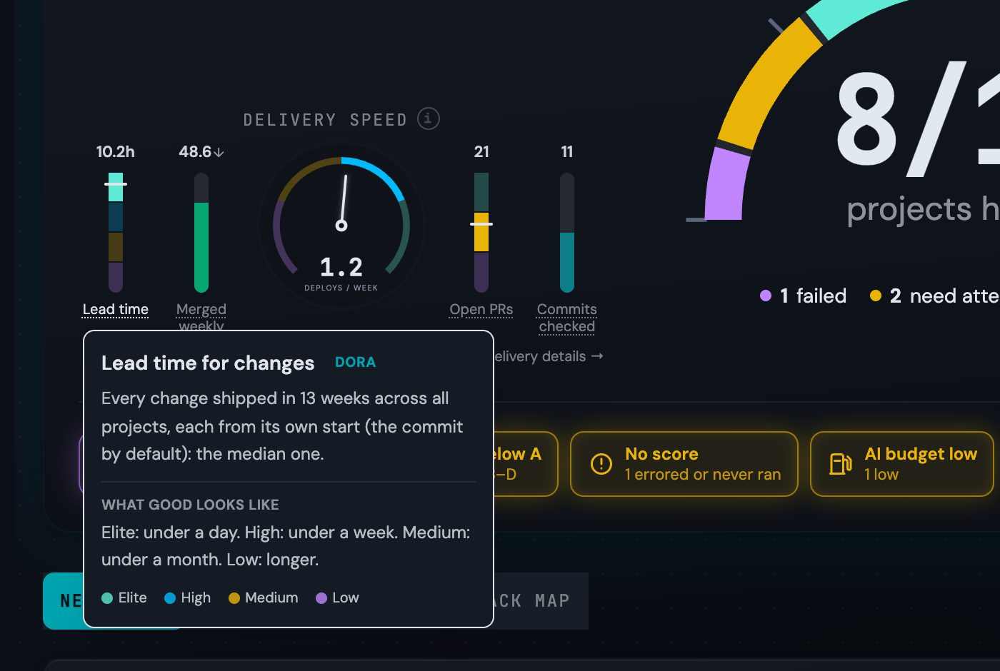
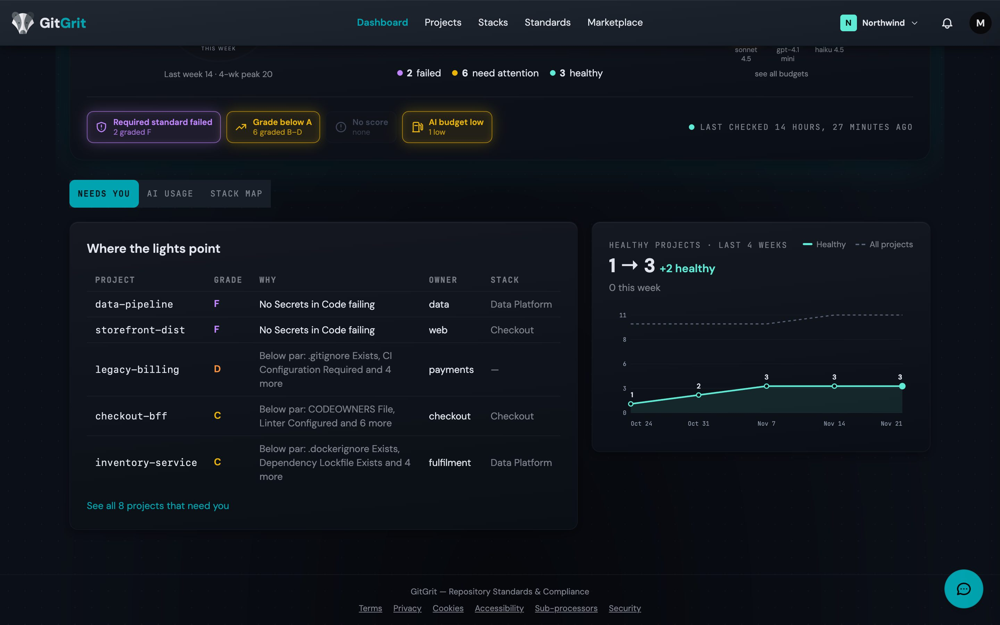
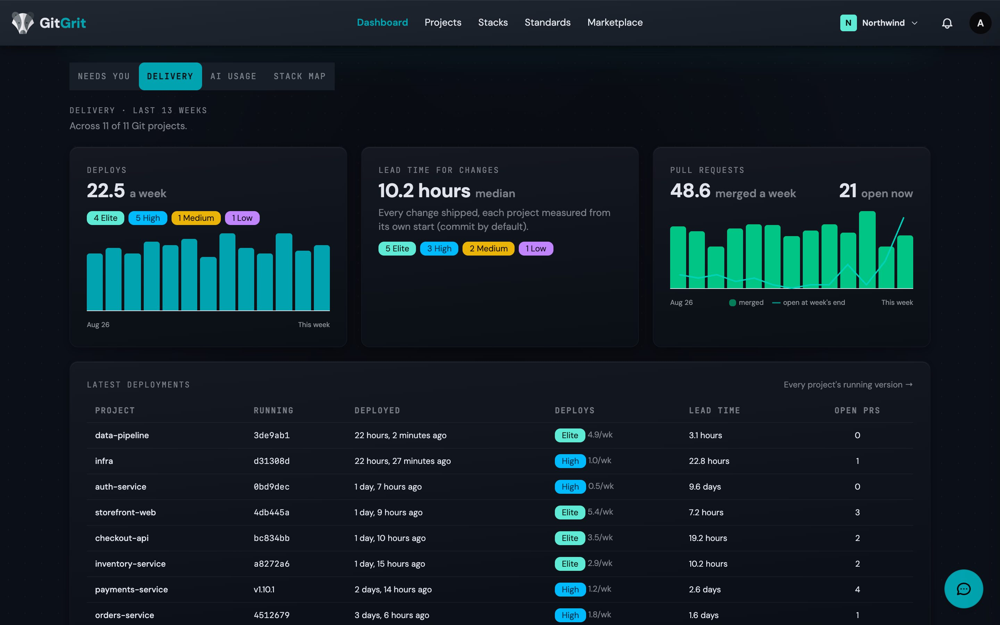
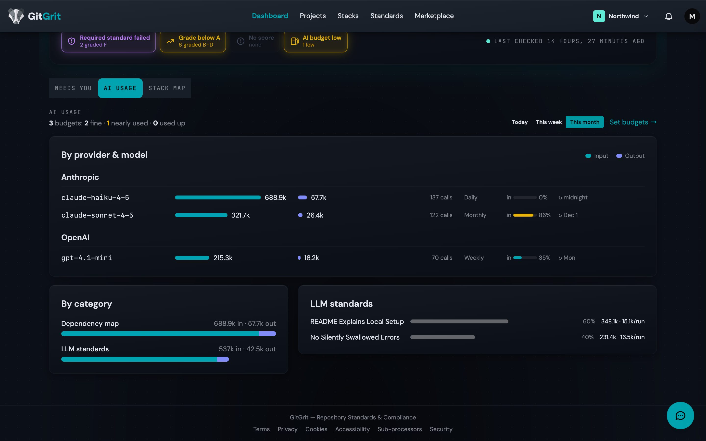
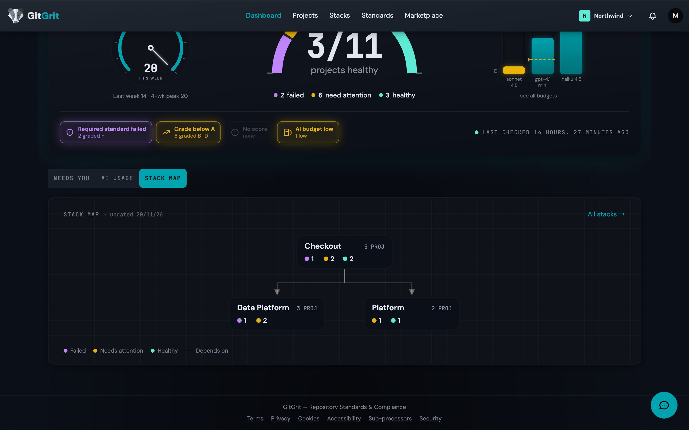

# Dashboard

The dashboard answers one question: **is anything wrong, and where?** It's laid out like a car's instrument panel. The instruments always show, and a warning light comes on only when something needs you.

<video class="gg-video" controls muted playsinline preload="metadata" poster="../../images/app/dashboard.jpg" aria-label="A tour of the dashboard: delivery speed, workspace health, warning lights and the Delivery tab">
  <source src="../../videos/dashboard.webm" type="video/webm">
</video>

The headline sums it up in words, for example *"You're in control. 1 failed, 2 need attention."*, with the workspace's stacks, projects and standards counted underneath. **New** adds a project, a stack, a standard or a standard from the marketplace.

## Instruments

| Instrument | What it shows |
|---|---|
| **Delivery speed** | How fast the workspace ships: deploys a week on a gauge, with lead time, pull requests and commits checked beside it ([below](#delivery-speed)) |
| **Workspace health** | How many projects are healthy, out of all of them, split into **failed**, **need attention** and **healthy** |
| **AI budget left** | A fuel gauge per AI model with a budget: what's left this period, and the dashed line where it counts as low ([AI budgets](ai.md#budgets)) |

Health uses the same colours everywhere in GitGrit: **purple** for failed, **yellow** for needs attention, **teal** for healthy. See [Health](../getting-started/projects.md#health).

### Delivery speed

The speedometer reads **deploys a week** for the median project: DORA ranks projects, so half the workspace deploys more often and half less. Its ring is coloured by [DORA tier](delivery.md#dora-tiers). Beside it, four bars:

| Bar | What it shows |
|---|---|
| **Lead time** | The median time for a change to reach production, across every change shipped in 13 weeks, each project counting from its own [start](delivery.md#when-lead-time-starts). The bar is split into DORA's tiers, with a marker where the workspace sits |
| **Merged weekly** | Pull requests merged a week, against the busiest week, with an arrow for the last four weeks against the four before |
| **Open PRs** | Pull requests open now, the bar coloured by how long they've been open |
| **Commits checked** | Commits GitGrit checked this week, against last week and the busiest of the last four weeks |

Hover the gauge or a bar for its numbers:

{ .gg-shot loading=lazy }

Each label under a bar is a link with a dotted underline. Hover it for what the metric means and what good looks like:

{ .gg-shot loading=lazy }

**Delivery details** opens the [Delivery tab](#delivery). See [Delivery Metrics](delivery.md).

## Warning lights

Below the instruments, four lights. Each is dark when there's nothing to say, and lit, with a count, when there is:

| Light | Comes on when |
|---|---|
| **Required standard failed** | A project is graded **F**: a Required standard failed it |
| **Grade below A** | Projects are graded B, C or D |
| **No score** | A standard errored or never ran on a project's newest commit, so it has no grade |
| **AI budget low** | A model's budget is running low or used up |

**Last checked** shows how long ago GitGrit last checked a commit anywhere in the workspace.

## Needs you

The first tab, **Needs you**, lists *where the lights point*: each project that needs attention, worst first, with its grade, **why** in one line, its owner and its stack.

{ .gg-shot loading=lazy }

- Failed projects come first, naming the Required standard that failed them.
- Then projects with no score, naming the standard that errored or never ran.
- Then the lowest grades, naming the standards keeping them down.

Beside it, **Healthy projects · last 4 weeks** charts how many projects were healthy each week against all of them, so you can see whether the team is getting ahead.

When every project is healthy, the list says so: *"Nothing. Every project is healthy."*

## Delivery

The **Delivery** tab shows the last 13 weeks of delivery across every project:

{ .gg-shot loading=lazy }

- **Deploys**: deploys a week across the workspace, how many projects sit in each [DORA tier](delivery.md#dora-tiers), and a bar per week.
- **Lead time for changes**: the median of every change shipped, and the projects per tier.
- **Pull requests**: merged a week and open now, with a bar per week and a line for those open at each week's end.
- **Latest deployments**: each project's running version, when it was deployed, its deploys a week and lead time with their tiers, and its open pull requests. **Every project's running version** opens the Projects list.

Hover a bar for its week. Click a project to open its [Delivery tab](delivery.md#a-projects-delivery-tab).

## AI usage

The **AI usage** tab shows the tokens your workspace spent on AI, for today, this week or this month:

{ .gg-shot loading=lazy }

- **By provider & model**: input and output tokens per model (models are priced apart, so they're counted apart), calls, and each model's budget beside it.
- **By category**: what the tokens were spent on: **Dependency map** (inferring each project's dependencies and suggested projects) or **LLM standards**.
- **LLM standards**: each AI-powered standard's tokens, so a standard that uses far more than the others stands out.

See [AI Standards & Budgets](ai.md).

## Stack map

The **Stack map** tab draws your stacks and how they depend on each other, each with its projects counted by health. Click a stack to open it. See [Stacks & the Stack Map](stacks.md).

{ .gg-shot loading=lazy }

## An empty workspace

A new workspace's dashboard is a pre-flight checklist instead: connect a git platform, pick your standards, add your first project, group projects into a stack, and give your AI models a budget. Each step links to where it's done. The [Quick Start](../getting-started/quickstart.md) walks through them.

## From the terminal

```sh
gitgrit overview          # the dashboard: health, lights, what needs you
gitgrit ai usage          # tokens per provider, model, category and standard
```

The API's `GET /api/v1/workspaces/{id}/overview/` returns the same in one call. See [REST API](../api/rest.md).
