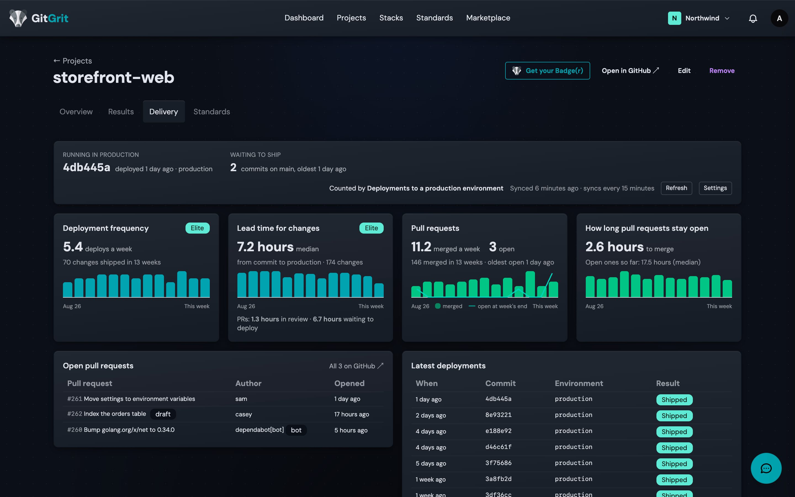
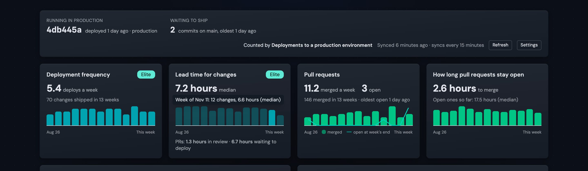
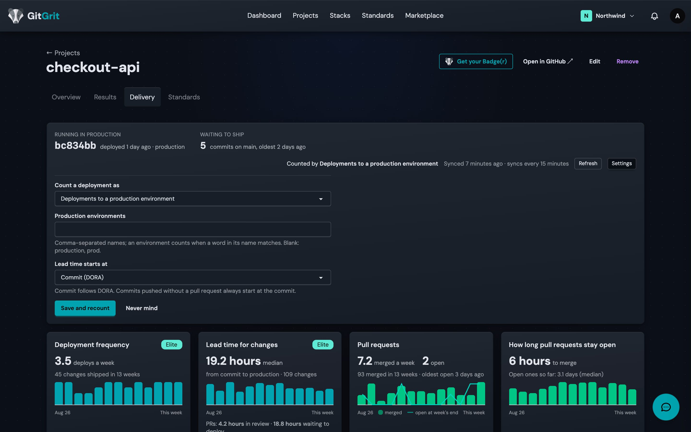

# Delivery Metrics

Standards tell you whether a project is built right. **Delivery** tells you how it ships: how often it deploys, how long a change takes to reach production, and how pull requests flow. GitGrit reads it from GitHub, with nothing to install in your pipeline.

<video class="gg-video" controls muted playsinline preload="metadata" poster="../../images/app/project-delivery.jpg" aria-label="A project's Delivery tab: weekly charts with hover, the settings, and what waits to ship">
  <source src="../../videos/delivery.webm" type="video/webm">
</video>

## What GitGrit measures

| Metric | What it is |
|---|---|
| **Deployment frequency** | Deploys a week, over the last 13 weeks ([DORA](#dora-tiers)) |
| **Lead time for changes** | The median time from a change's [start](#when-lead-time-starts) to running in production ([DORA](#dora-tiers)) |
| **Pull requests** | Merged a week, open now, and the oldest open one |
| **Time to merge** | The median time a pull request stays open before it's merged, and how long the open ones have been open so far |
| **Running in production** | The commit or tag deployed last, and when |
| **Waiting to ship** | Commits on the default branch not deployed yet, and the oldest of them |

Pull requests by bots (Dependabot, Renovate…) and drafts are left out of the pull request numbers.

## A project's Delivery tab

Open a project and pick **Delivery**:

{ .gg-shot loading=lazy }

- At the top, what's **running in production** and what's **waiting to ship**.
- **How it's counted**: the [deployment strategy](#how-a-deployment-is-counted), when GitGrit last synced, **Refresh** and **Settings**.
- Four charts, one bar per week for 13 weeks: **Deployment frequency**, **Lead time for changes**, **Pull requests** (merged, with a line for those open at each week's end) and **How long pull requests stay open**. Deployment frequency and lead time carry their [DORA tier](#dora-tiers).
- Under lead time, for changes that came through a pull request: how long they spent **in review** and **waiting to deploy** after the merge.
- **Open pull requests**, oldest first, and **Latest deployments**, newest first.

Hover a bar for its week:

{ .gg-shot loading=lazy }

The project's **Overview** sums it up in its **Delivery** card: running version, deploys a week, lead time, waiting to ship, open and merged pull requests, and time to merge. See [The project page](../getting-started/projects.md#the-project-page).

## How a deployment is counted

Teams ship in different ways, so each project picks the signal that matches how it ships. Click **Settings** on the Delivery tab:

{ .gg-shot loading=lazy }

| Count a deployment as | Each deployment is | Setting |
|---|---|---|
| **Detect automatically** (default) | Production deployments if the repository has any, else release tags, else pushes to the default branch | |
| **Deployments to a production environment** | A successful deployment to a production environment, as GitHub records it (a GitHub Actions job with an `environment` does) | **Production environments**: names to match, comma-separated; blank means `production`, `prod` |
| **Release tags** | A tag matching the release pattern | **Release tag pattern**, such as `v*` or `release-*` |
| **A deploy workflow** | A successful run of that CI workflow on the default branch | **Deploy workflow file**, such as `deploy.yml` |
| **Pushes to a deploy branch** | A push to that branch | **Deploy branch**, such as `production` |
| **Pushes to the default branch** | A push to the default branch: exact for continuous deployment, an approximation otherwise | |

**Save and recount** recounts the 13 weeks with the new settings.

### When lead time starts

Lead time always ends when a change runs in production. **Lead time starts at** sets where it begins:

| Start | From |
|---|---|
| **Commit (DORA)** (default) | When each commit was written. This is DORA's definition, so the tier compares with DORA's published bands. |
| **Ready for review** | When its pull request was ready for review |
| **Merge** | When its pull request was merged |

A commit pushed without a pull request always starts at the commit.

## DORA tiers

GitGrit places deployment frequency and lead time in DORA's performance bands:

| Tier | Deployment frequency | Lead time for changes |
|---|---|---|
| **Elite** | On demand: deploys most days (3 or more a week) | Under a day |
| **High** | Deploys every week | Under a week |
| **Medium** | Deploys every month | Under a month |
| **Low** | Less than once a month | Longer |

A project's deployment frequency tier reads its weeks, not just its average, so one busy week doesn't make a project Elite. A project with nothing in the 13 weeks has **No data**.

## Across the workspace

The [dashboard](dashboard.md) shows delivery for every project together:

- **Delivery speed**, beside workspace health: a gauge for deploys a week, with lead time, pull requests merged a week, open pull requests and commits checked as bars beside it. See [Delivery speed](dashboard.md#delivery-speed).
- The **Delivery** tab: each metric's weekly chart for the workspace, how many projects sit in each tier, and the **latest deployments** of every project.

On the **Projects** list, the **Delivery** and **Lead time** columns show each project's running version, deploys a week and lead time with their tiers. Sort by **Last deployed**, **Deploys a week**, **Lead time** or **Open pull requests**, and group by **Deploy tier**. See [Search & Bulk Edit](search.md).

## Keeping it current

GitGrit syncs each project's delivery from GitHub **every 15 minutes**, and pages always show what the last sync stored. GitHub also tells GitGrit when something changes (a pull request, a push to the default or deploy branch, a release, and through the GitHub App a deployment or a finished workflow run), so most changes show up within seconds.

**Refresh** on the Delivery tab syncs the project now. It works again 5 minutes after the last sync, so a busy button can't spend your GitHub rate limit. GitGrit also caches what GitHub sends and slows down before the limit runs out.

If GitHub refuses the connection's token, or the token can't read something, the Delivery tab says which permission is missing and keeps the last numbers it had.

## What GitGrit needs

Delivery metrics come from GitHub repositories, connected through the GitHub App or an access token. GitLab repositories and [artifact projects](../getting-started/artifact-projects.md) aren't measured yet.

GitGrit only reads. On top of what it needs for standards, it reads:

| Permission | For |
|---|---|
| **Pull requests**: read | Pull request flow, time to merge, and lead time from review or merge |
| **Deployments**: read | Deployments to a production environment |
| **Actions**: read | Runs of a deploy workflow |

The GitHub App asks for these when you install it, or asks your organization to approve them if it's already installed. For an access token, add them to the token. See [Connect a platform first](../getting-started/projects.md#connect-a-platform-first).
