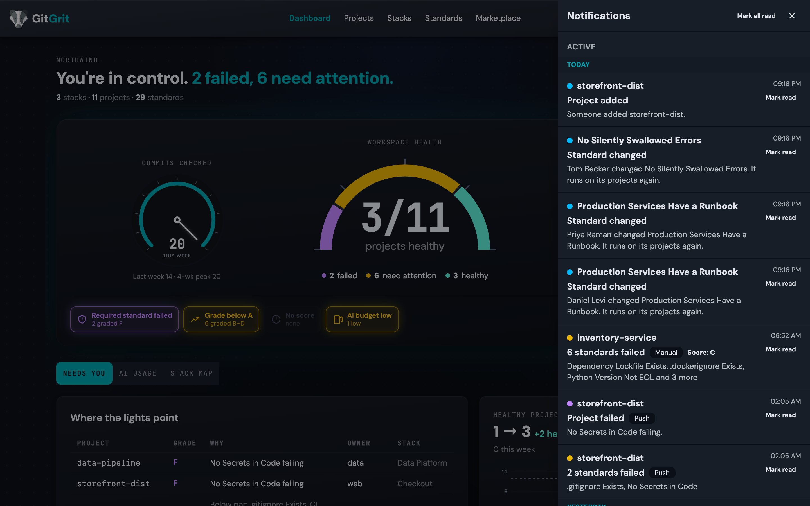

# Notifications

The bell in the top bar tells you what changed while you weren't looking. A badge on it counts what you haven't read.

{ .gg-shot loading=lazy }

Click it to open the pane:

- **Active**: what you haven't read yet, newest first, grouped by day. Each one names the project, standard or person, says what happened, and links to where you can act on it.
- **History**: what you've read. **Show more** loads older ones.
- **Mark read** on one, or **Mark all read**. Opening one marks it read too. You can mark it unread again from History.

## What you're told, and who

GitGrit tells the people who can act on it: the workspace's **owners and admins**, and for runs, **whoever triggered the run**. Nobody is told about their own change.

| Notification | When | Who |
|---|---|---|
| **Project failed** | A run failed a project: a Required standard failed where it hadn't before | owners, admins, the run's triggerer |
| **Standards failing** | A run left standards failing | owners, admins, the run's triggerer |
| **Required standard couldn't run** | A Required standard errored, so the commit has no score | owners, admins, the run's triggerer |
| **Couldn't evaluate** | A run couldn't be evaluated at all: every standard errored, or the run itself failed | owners, admins, the run's triggerer |
| **Runs timed out** | Runs nobody finished were expired | owners, admins, the run's triggerer |
| **Git connection broken** | The platform refused GitGrit's token | owners, admins, the run's triggerer |
| **Dependency map broke** | A project's map that used to build failed | owners, admins, the run's triggerer |
| **AI provider refused** | The provider rejected the key, has no credit, or blocks the model | owners, admins |
| **AI budget low** / **used up** | A model's [budget](ai.md#budgets) reached its low mark, or its limit | owners, admins |
| **Project added** / **removed** | Someone added or removed a project | owners, admins |
| **Standard changed** | Someone edited, enabled, disabled or deleted a standard | owners, admins |
| **Member joined** / **removed** | The team changed | owners, admins |
| **Role changed** | A member's role changed | owners, admins, and that member |

When a run couldn't be evaluated at all, you get **Couldn't evaluate** alone, not also **Standards failing** or **Required standard couldn't run**.

## Emails

Notifications live in the app. GitGrit emails you only for your account and your team: confirming your email address, resetting your password, an invitation to a workspace, and (for [superusers](../self-hosting/operations.md#superusers)) new access requests and approvals.
