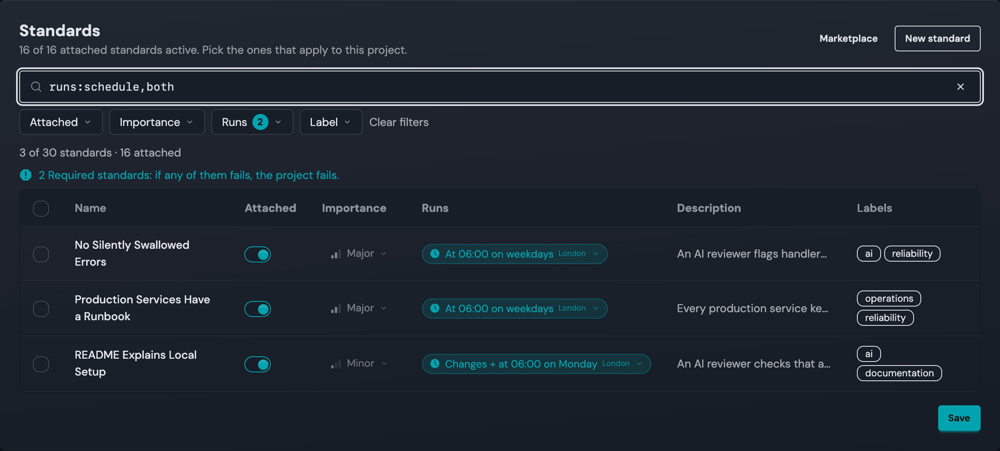
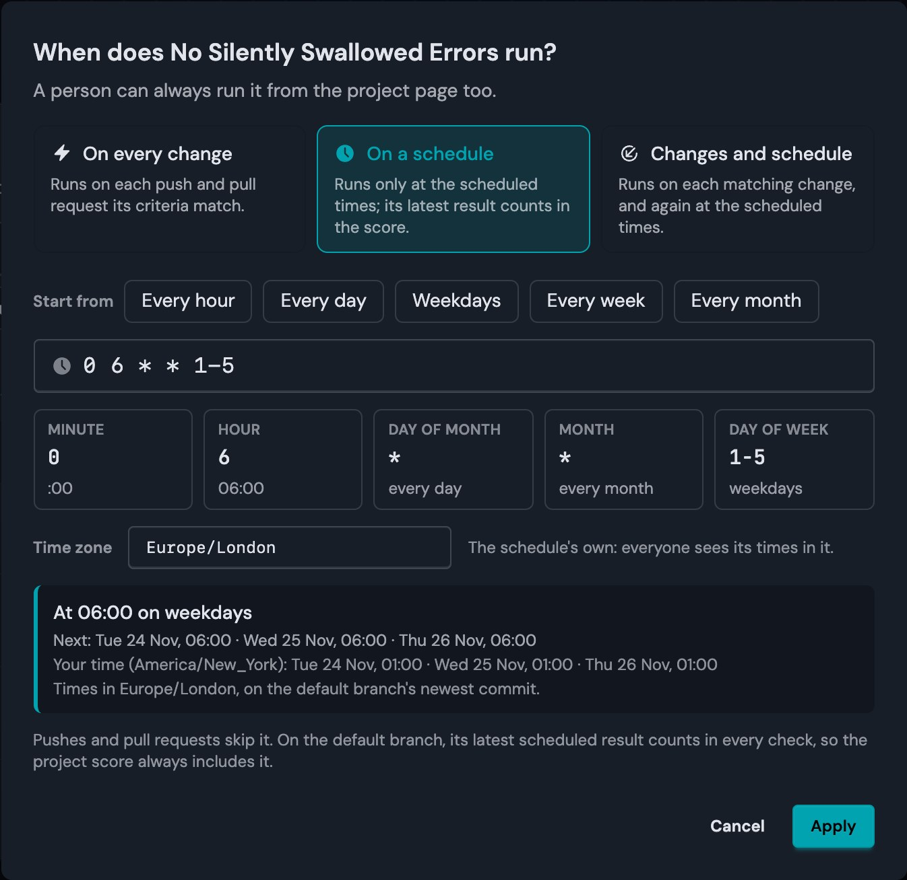
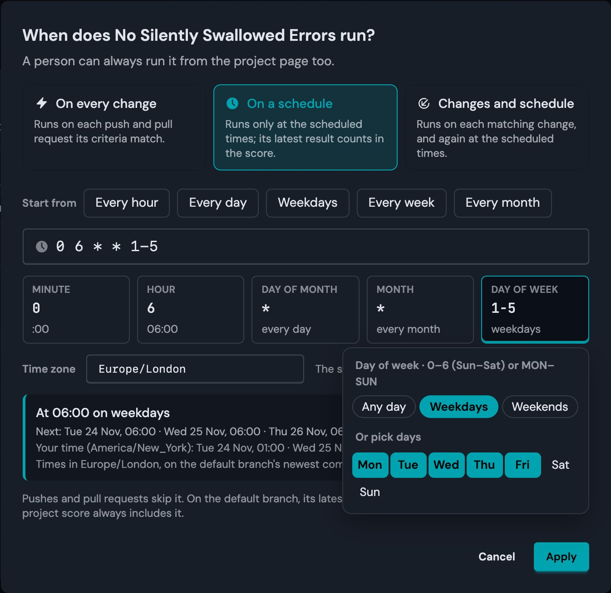
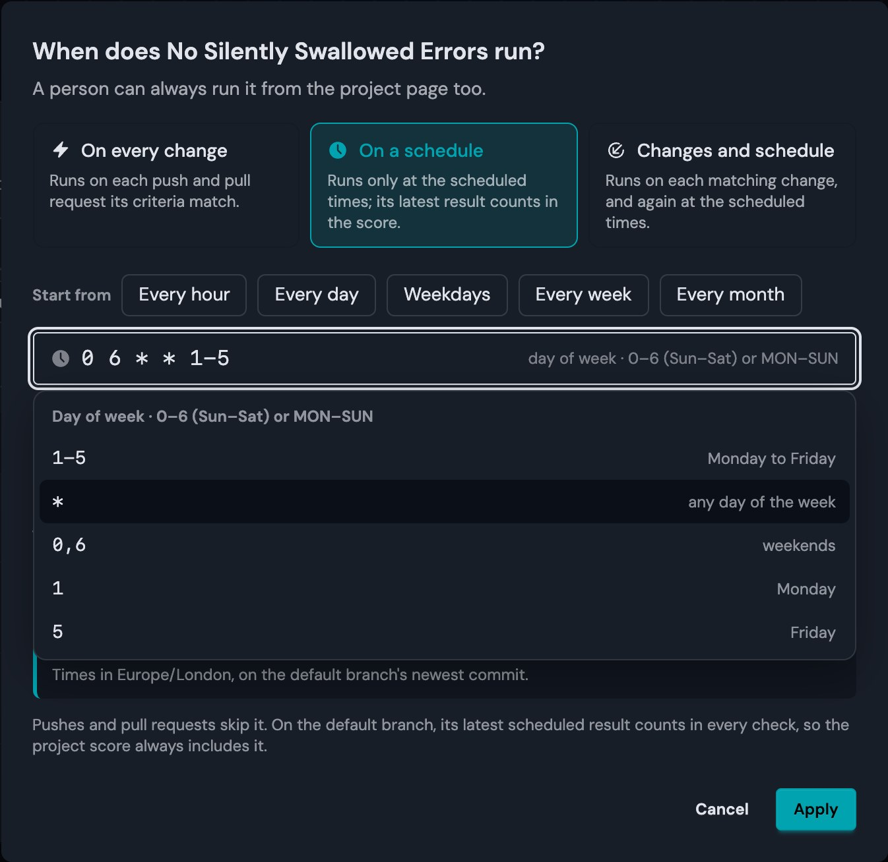
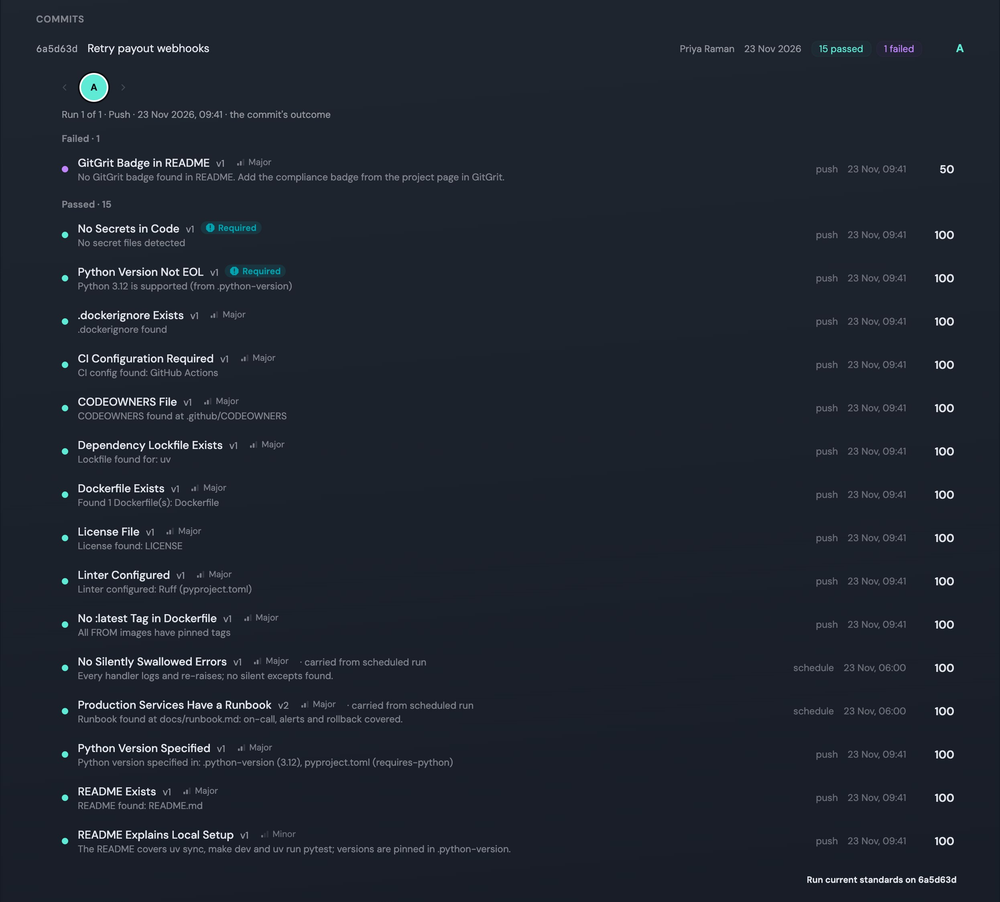
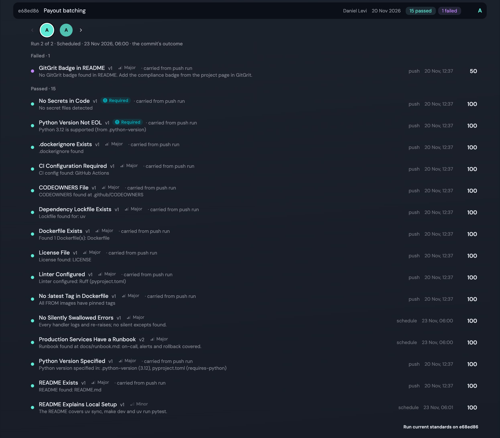

# Scheduled Standards

A standard runs **on every change** by default: each push and pull request it applies to. Some don't need to. An [AI standard](ai.md) that reviews error handling costs tokens on every push, but the answer rarely changes from one commit to the next. Put it **on a schedule**, say weekdays at 06:00, and it runs once a day on the default branch instead. Its latest result still counts in the project score.

<video class="gg-video" controls muted playsinline preload="metadata" poster="../../images/app/schedule-standards.jpg" aria-label="Selecting two AI standards on a project's Standards tab and putting them on a weekday 06:00 schedule">
  <source src="../../videos/schedules.webm" type="video/webm">
</video>

Schedules belong to the attached standard, like [importance](../getting-started/projects.md#importance): the same standard can run on every change on one project and once a week on another.

## What runs a standard

| Runs | When it runs | Use it for |
|---|---|---|
| **On every change** (default) | Each push and pull request it applies to | Fast, cheap checks: files exist, a version is pinned |
| **On a schedule** | Only at its scheduled times, on the default branch | Expensive or slow checks whose answer changes slowly: AI reviews, dependency audits |
| **Changes and schedule** | Both: on each change, and again at its times | Checks that can change with no push at all: an end-of-life date, a deprecated base image |

Anyone can still run any standard by hand from the project page.

{ .gg-shot loading=lazy }

## Set a schedule

On a project's **Standards** tab, the **Runs** column shows what runs each attached standard, and a schedule's time zone. Click a row's chip, or check several rows and click **Runs** in the bar above the table, then click **Save**.

The editor writes the schedule as a [cron expression](https://en.wikipedia.org/wiki/Cron#Cron_expression), the five fields developers already know, without making you remember them:

- **Start from** a preset: every hour, day, weekday, week or month. Presets keep the time of day you already picked.
- **Pick each field from its menu**: *Every hour*, steps such as *every 6 hours*, or tick the values you want. Ticked values that follow each other become a range (`1-5`).
- **Or type it.** The box names the field the caret is in and suggests values for it.

Under the fields, pick the schedule's **time zone**. GitGrit then reads the schedule back in words, with its next three times, so you never guess what a `*` means:

{ .gg-shot loading=lazy }

{ .gg-shot loading=lazy }

{ .gg-shot loading=lazy }

| Cron | Reads |
|---|---|
| `0 6 * * 1-5` | At 06:00 on weekdays |
| `0 9 * * *` | Every day at 09:00 |
| `30 2 * * 0` | At 02:30 on Sunday |
| `0 */6 * * *` | Every 6 hours |
| `0 6 1 * *` | At 06:00 on day 1 of the month |

`@hourly`, `@daily`, `@weekly` and `@monthly` work too, and are spelled out when you save.

A few rules:

- **A schedule has its own time zone.** Pick it under the fields (type to search every zone). It starts in the zone on your profile, else your browser's. The schedule's times are the same for everyone: a teammate in New York reads "06:00 · Madrid", not their own 00:00. When your zone is another, the reading adds your own times under the schedule's.
- **More often than hourly is allowed but flagged.** The editor warns you, since an AI standard on `*/5 * * * *` costs more than one on every push.
- **Missed times are skipped, not caught up.** If GitGrit was down at 06:00, the standard runs at its next time.
- **Every scheduled standard of a project that is due at the same minute runs in one check.**

## What a scheduled run checks

A scheduled run checks the **newest commit on the project's default branch**, the commit the project's score comes from. It runs the standards that are due and that [apply](../getting-started/standards.md) to that branch.

A standard that runs only on a schedule is **not part of the checks of other branches or of pull requests**: a feature branch's grade comes from its standards that run on changes. A standard on **Changes and schedule** still runs on every branch's pushes; only its scheduled runs are limited to the default branch.

## The score

A project's score is still its default branch's newest commit ([The score](../getting-started/projects.md#the-score)). What changes is that **every check on the default branch now covers every attached standard**, including the ones it didn't run:

- A **push** runs the standards that run on changes. Each schedule-only standard **carries** its latest result on the branch.
- A **scheduled run** runs the due standards on the newest commit. Every other standard carries its latest result.

So the score always counts every standard, and moves when a scheduled run finds something, even with no push that day. A carried result says so, and where it came from:

{ .gg-shot loading=lazy }

A scheduled run is a check of its own on the commit's timeline, marked **Scheduled**:

{ .gg-shot loading=lazy }

A carried result is the newest **finished** run of that standard on the same branch, started before the check. A standard that has never run on the branch has nothing to carry, so the check has [no score](../getting-started/projects.md#the-score) until it runs: when you put a new standard on a schedule, run it once by hand rather than wait for its first time. If a run finishes after a newer check already carried an older result, that newer check is scored again.

!!! tip "Cut AI spend"
    Filter the Standards tab to `label:ai`, check every row and set **Runs** to a daily schedule: their tokens go from once per push to once per day per project, and you can see the difference under [AI usage](ai.md#ai-usage).

## Find scheduled standards

The Standards tab's filter takes a `runs` field: `runs:changes`, `runs:schedule`, `runs:both`, or several at once, `runs:schedule,both` ([Search & Bulk Edit](search.md)).

On the Results tab a scheduled check reads **Scheduled**; in [usage](usage.md), its runs count as **Scheduled run**.
