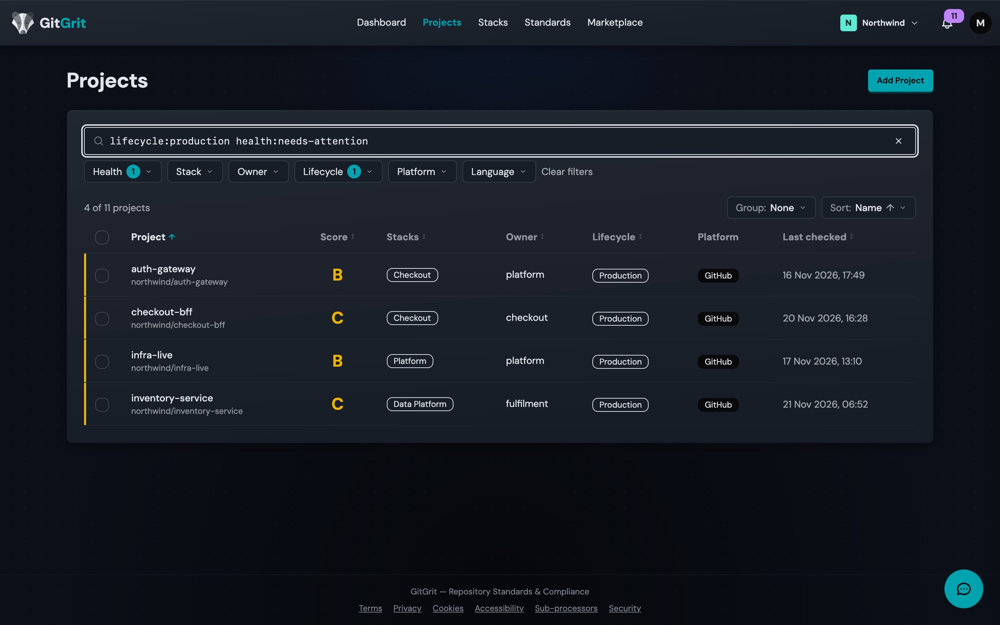
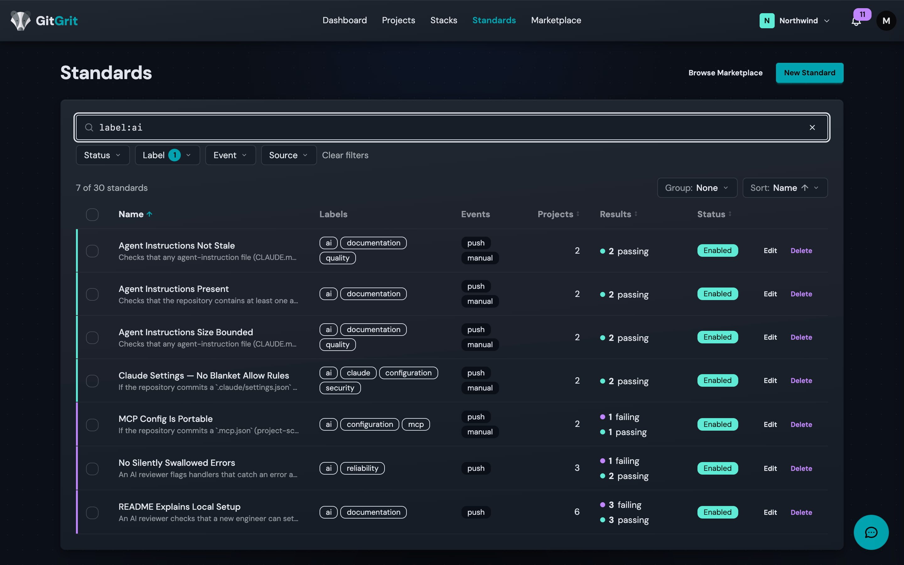
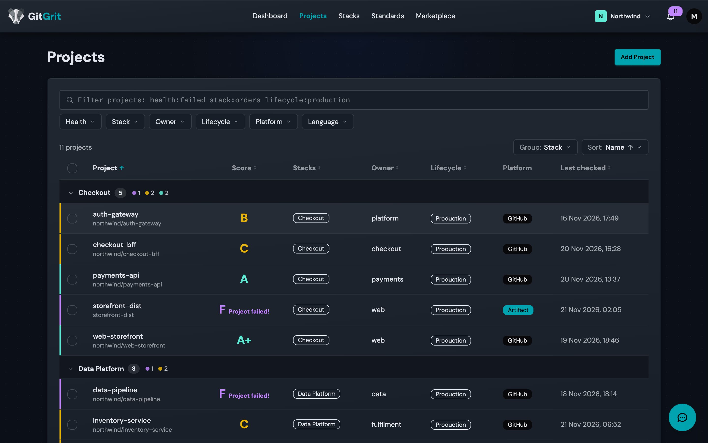
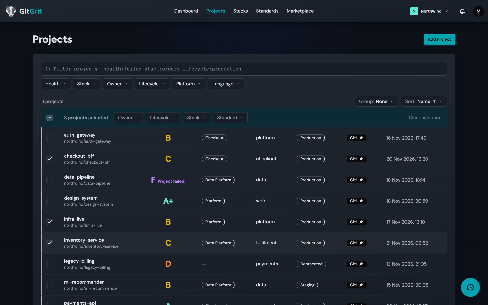

# Search & Bulk Edit

The Projects, Stacks, Standards and Marketplace lists all work the same way: a **filter box** that understands GitHub-style qualifiers, menus that build the query for you, **sort** and **group** controls, and **bulk edit** for the rows you check.

<video class="gg-video" controls muted playsinline preload="metadata" poster="../../images/app/projects-grouped.jpg" aria-label="Grouping projects by stack, filtering, and selecting rows to bulk edit">
  <source src="../../videos/search_bulk.webm" type="video/webm">
</video>

## Filter

Type in the box, or pick from the menu buttons under it (**Health**, **Stack**, **Owner**…). The list filters as you type, and the count above it says how many rows match: *"4 of 11 projects"*.

{ .gg-shot loading=lazy }

The syntax is GitHub's:

| You type | It means |
|---|---|
| `health:failed` | a qualifier: the field `health` is `failed` |
| `stack:checkout,payments` | either value matches |
| `-lifecycle:deprecated` | a leading `-` excludes |
| `owner:"platform team"` | quotes keep spaces in a value |
| `payments` | a free word, matched against what the row shows |
| `lifecycle:production health:needs-attention` | every part must match |

Suggestions appear under the box as you type a field or a value: pick one with the arrow keys and **Enter** or **Tab**, or the mouse. **Clear filters** empties the box.

### Fields per list

| List | Fields |
|---|---|
| **Projects** | `health` (`healthy`, `needs-attention`, `failed`, `unknown`), `stack`, `owner`, `lifecycle`, `platform` (`github`, `gitlab`, `artifact`), `language`, `name`, `path` |
| **Stacks** | `has` (stacks with a project of that health: `has:failed`), `owner`, `project`, `name`, `description` |
| **Standards** | `is` (`enabled`, `disabled`, `draft`), `label`, `event` (`push`, `pull_request`, `tag`), `source` (`marketplace`, `custom`), `name`, `description` |
| **A project's Standards tab** | `is` (`attached`), `importance` (`required`, `major`, `minor`), `label`, `name`, `description` |
| **Marketplace** | `is` (`available`, `installed`, `update`), `pack`, `label`, `author`, `event`, `name`, `description` |

For example, on Standards, `label:ai` lists the AI-powered ones:

{ .gg-shot loading=lazy }

## Sort and group

**Sort** orders the list by any column (click a column header, or use the menu; click again to reverse). **Group** splits it into sections, each with its own count and health:

{ .gg-shot loading=lazy }

| List | Group by |
|---|---|
| Projects | owner, stack, lifecycle, platform, health |
| Stacks | owner |
| Standards | label, event, status, source |
| Marketplace | pack, label, author, status |

Filters, sort and grouping stay in the page's URL, so you can bookmark a view or send it to a teammate.

## Bulk edit

Check rows (or the box in the header, for every row shown) and a bar appears with what you can do to all of them at once:

{ .gg-shot loading=lazy }

| List | Bulk actions |
|---|---|
| **Projects** | set **owner**, set **lifecycle**, add to or remove from a **stack**, attach a **standard** (with its importance) or detach one |
| **Standards** | **enable**, **disable**, add or remove a **label**, **delete** |
| **Marketplace** | **install** the checked standards, or **update** the installed ones |

GitGrit tells you what changed and on which rows. Attaching a standard in bulk runs it on each project, as attaching it one project at a time does.

!!! tip "Fix a finding everywhere"
    Filter Standards to the one you care about, then on Projects filter `-stack:legacy language:python` and attach it to every match at once. See [Roll out a security fix everywhere](../use-cases/security-fix-everywhere.md).
