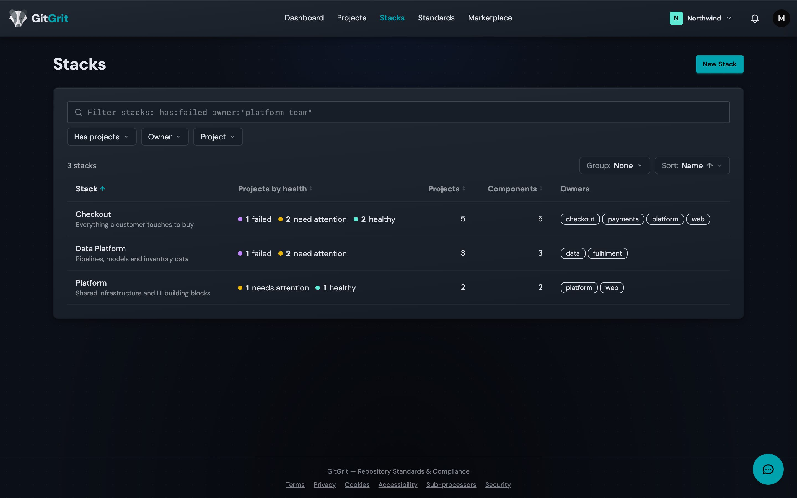
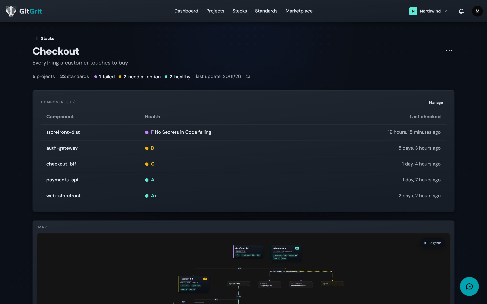
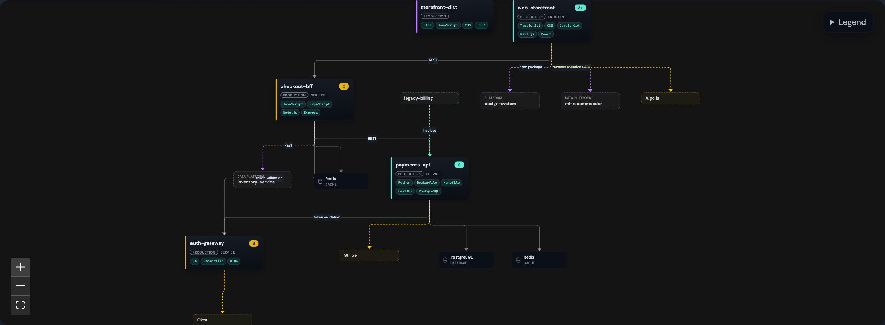

# Stacks & the Stack Map

A **stack** groups the projects that make up one system, such as *Checkout* or *Data Platform*. Health rolls up per stack, so you can see which systems are in good shape and which need work, and a **map** shows how their parts depend on each other.

<video class="gg-video" controls muted playsinline preload="metadata" poster="../../images/app/stack-detail.jpg" aria-label="Opening a stack: its components, then its map">
  <source src="../../videos/stacks.webm" type="video/webm">
</video>

## The Stacks list

{ .gg-shot loading=lazy }

Each stack shows its projects counted by health (**failed**, **need attention**, **healthy**), how many projects and components it has, and their owners. Filter, sort and group it like every list: `has:failed` finds the stacks with a failed project. See [Search & Bulk Edit](search.md).

Click **New Stack** to create one: give it a name, a description, and pick its projects.

## A stack's page

{ .gg-shot loading=lazy }

- **Header**: how many projects and standards the stack has, and its projects counted by health.
- **Components**: each component, worst first, with its grade, **what's wrong** in a few words (*"No Secrets in Code failing"*) and when it was last checked. Click one to open its project.
- **Map**: the stack's components and what they depend on (below).
- **Manage**: add or remove components; **Edit** renames the stack or changes its description.

### Components

A project is one repository. Its **components** are the deployable things inside it: a plain repository has one, its root; a monorepo can hold several (an API, a web app, a worker). Stacks are made of components, so one monorepo can belong to several stacks, one component each.

You can also add a project to stacks when you [add the project](../getting-started/projects.md), or many projects at once with [bulk edit](search.md#bulk-edit).

## The stack map

{ .gg-shot loading=lazy }

The map draws each component as a card: its name, grade, lifecycle, kind (service, frontend, library, job, infrastructure) and technologies. Lines show what depends on what, labelled with how (*REST*, *npm package*, *token validation*). It also shows what the components use:

- **Infrastructure**: databases, caches, queues and object storage (PostgreSQL, Redis, Kafka, S3)
- **Third parties**: services outside your workspace (Stripe, Okta, Algolia)
- **Components in other stacks**, dimmed, labelled with their stack

Zoom with the controls in the corner, drag to pan, and open **Legend** for what each line and colour means.

### How the map is built

GitGrit reads each project's default branch with your AI model (the workspace's **reasoning** role) and infers its components and dependencies, then keeps the map current as code is pushed. The files it read are listed on the project, so you can see what a map is grounded in. The tokens it spends appear on the dashboard as **Dependency map** ([AI usage](ai.md#ai-usage)).

The map needs an [LLM provider](ai.md#providers-and-roles) with a budget. Without one, stacks and their health work as usual; there's just no map.

## On the dashboard

The dashboard's **Stack map** tab draws your stacks and how they depend on each other, each with its projects counted by health. See [Dashboard](dashboard.md#stack-map).

## From the terminal

```sh
gitgrit stack list
gitgrit stack create Checkout --description "Everything a customer touches to buy"
gitgrit stack add Checkout                                  # this repository
gitgrit stack add Checkout northwind/web-storefront northwind/mono:services/cart
gitgrit stack remove Checkout northwind/legacy-billing
gitgrit stack view Checkout                                 # health, components, map
gitgrit stack components --project northwind/payments-api   # a project's components
gitgrit stack edit Checkout --name "Checkout & Payments"
gitgrit stack delete Checkout --yes
```

A component is named `org/repo` for a repository's root, or `org/repo:path` for one inside a monorepo.
