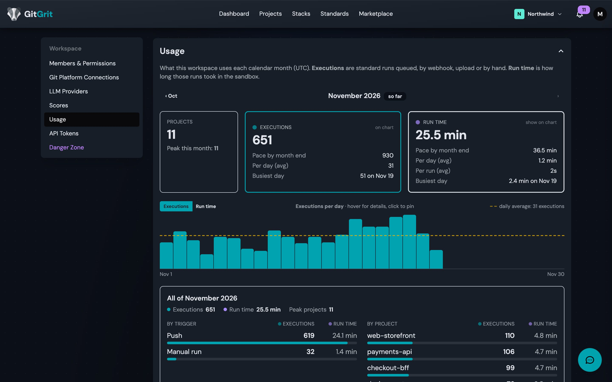

# Usage

**Workspace Settings → Usage** shows what your workspace uses each calendar month (UTC):

{ .gg-shot loading=lazy }

| Measure | What it counts |
|---|---|
| **Projects** | projects in the workspace now, and the most at once this month |
| **Executions** | standard runs queued: by a push or pull request, an upload, or by hand. One standard on one commit is one execution. |
| **Run time** | how long those runs took in the sandbox |

For the current month you also get the **pace by month end**, the **per-day average**, the average **per run** and the **busiest day**.

The chart shows **executions per day** (or **run time**, with the toggle), with the daily average as a dashed line. Hover a bar for that day's numbers; click to pin it.

**All of** *month* breaks the month down:

- **By trigger**: push, pull request, tag, upload, manual run
- **By project**: which projects run the most, and take the longest

Step back through earlier months with **‹**.

!!! tip "Bringing usage down"
    A standard runs on every push to every branch its **Branch/Tag Filter** matches. If most of your executions come from feature branches, narrow the standards that only matter on `main` with `^main$`. See [Writing Standards](../getting-started/standards.md#criteria-filters).
