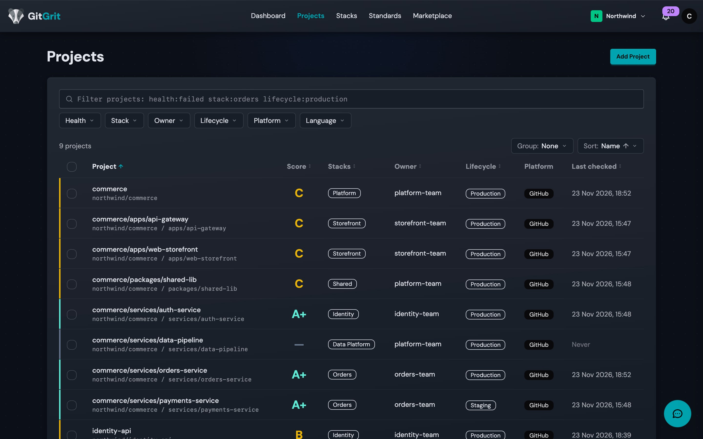
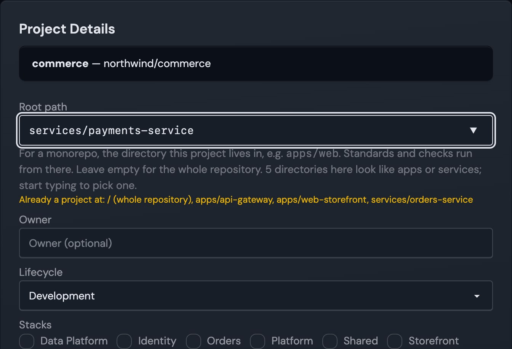
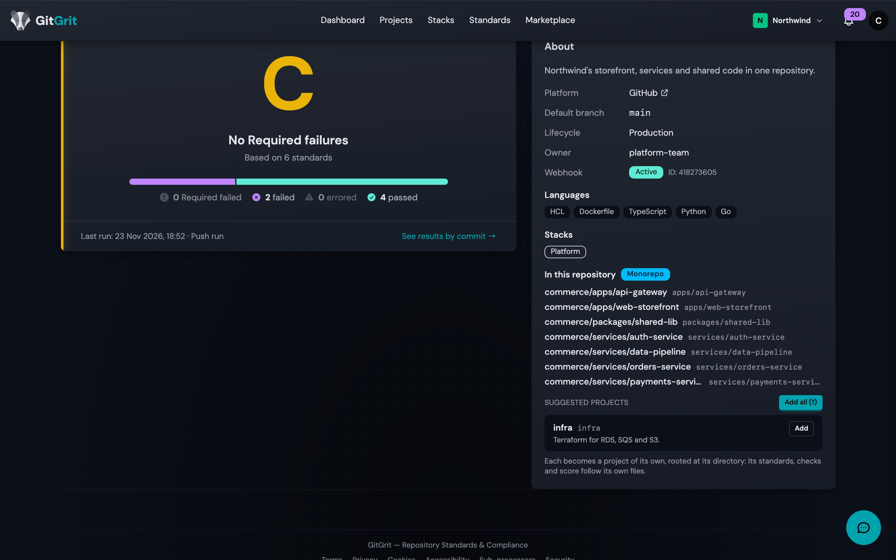
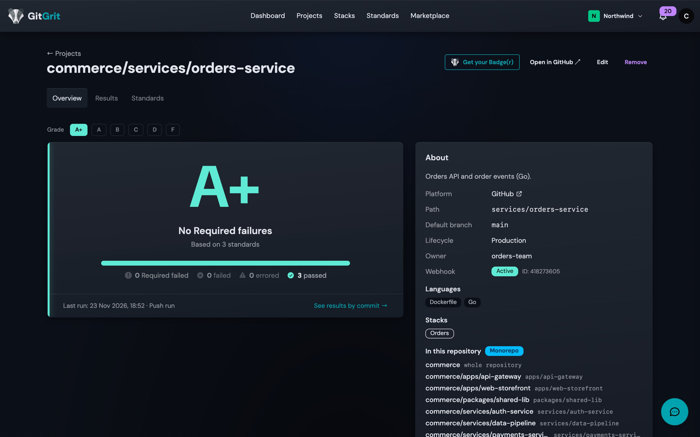
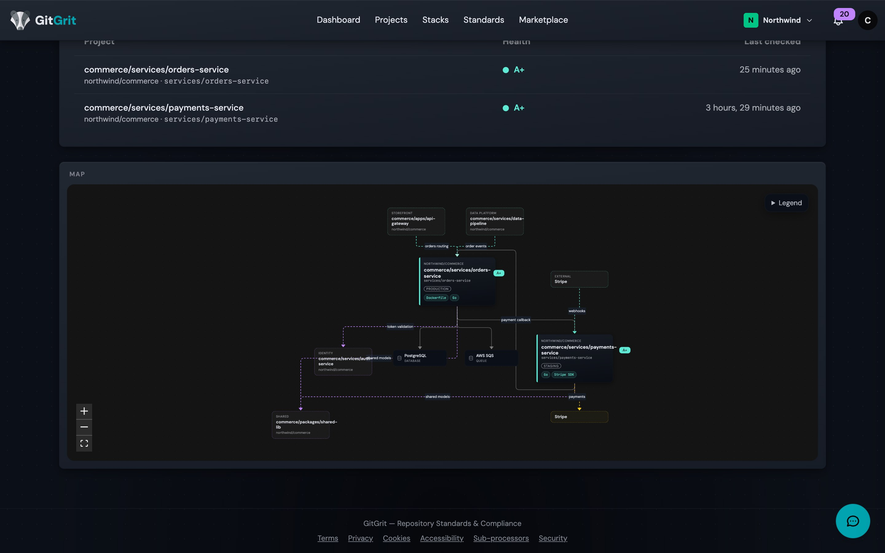

# Monorepos

A monorepo holds several things you build and ship on their own: a web app, an API, a worker, a shared library. In GitGrit each one can be a **project of its own**, rooted at its directory inside the repository. It gets its own standards, its own score and history, its own stacks and its own card on the [stack map](../features/stacks.md#the-stack-map).

<video class="gg-video" controls muted playsinline preload="metadata" poster="../../images/app/monorepo-repository.jpg" aria-label="A monorepo's whole-repository project: its projects, then adding a suggested one">
  <source src="../../videos/monorepo.webm" type="video/webm">
</video>

{ .gg-shot loading=lazy }

A typical monorepo becomes one project per root path:

| Root path | What to attach |
|---|---|
| *(empty: the whole repository)* | Repository-wide standards: CODEOWNERS, CI, LICENSE, README, secrets |
| `apps/web-storefront` | App standards: `package.json`, TypeScript, Dockerfile |
| `services/orders-service` | Service standards: Dockerfile, no `:latest` tag |

## Add a project at a path

When you [add a repository](projects.md#add-a-repository), fill in **Root path** with the directory the project lives in, e.g. `apps/web`. Leave it empty for the whole repository.

The field suggests the repository's directories as you type: apps, services and libraries first (directories holding a `package.json`, `go.mod`, `pyproject.toml`, `Dockerfile` and the like), then every other directory. Paths that are projects already are left out. A repository that is already a project can be added again at another path: the search and the form show the paths it is a project at.

{ .gg-shot loading=lazy }

From the terminal:

```sh
gitgrit project add northwind/commerce                         # the whole repository
gitgrit project add northwind/commerce --path apps/web-storefront
gitgrit project add northwind/commerce --path services/orders-service
```

Or over the API: `POST projects/` with `"root_path": "apps/web"` ([REST API](../api/rest.md)).

## Suggested projects

Add the whole repository first. When GitGrit maps its dependencies (with your workspace's [AI model](../features/ai.md#providers-and-roles)), it lists the apps, services and libraries it finds inside it as **suggested projects** on the project page, under **In this repository**. **Add** one, or **Add all**: each becomes a project at its directory, with the name, description and tech labels GitGrit found. Attach its standards from its own page.

{ .gg-shot loading=lazy }

## What changes for a project at a path

- **Standards read its directory.** A standard that checks `package.json` or `Dockerfile` reads `apps/web/package.json`. Standards that need a file at the repository root (a workspace lockfile, CI config) can still read it with `get_repository_file_content` ([ProjectContext](../api/project-context.md)).
- **Repository-wide standards go on the whole-repository project.** CODEOWNERS, CI config, LICENSE and README live at the root: attach them to the project with no root path, and the app and service standards to the projects at their paths.
- **A push runs only the projects it touched.** A push that changes `services/api/` runs the whole-repository project and `services/api`, not `apps/web`. When GitGrit can't tell what a push changed, it runs them all.
- **Its commits are the ones that touched its directory**, and its score follows them.
- **Its languages are its own**, counted from its files, so language-specific standards fit it.
- **One webhook per repository**, however many projects it holds.
- **The CLI picks the project you stand in.** Inside `apps/web` of a clone, `gitgrit health` is about the `apps/web` project.
- Each project counts once towards your plan's projects ([Pricing](../pricing.md)).

{ .gg-shot loading=lazy }

## On the stack map

Every project is a card of its own on the [stack map](../features/stacks.md#the-stack-map), labelled with its repository and path, so a monorepo's services connect to each other, and to projects in other repositories, like any other services.

{ .gg-shot loading=lazy }
