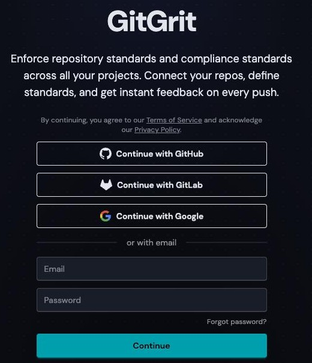
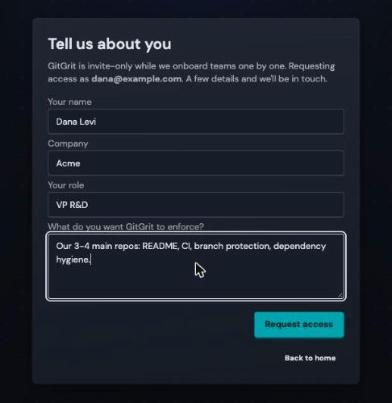
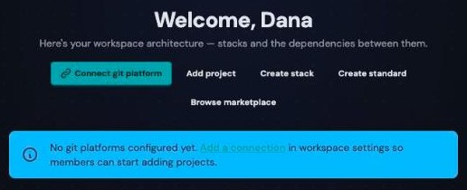
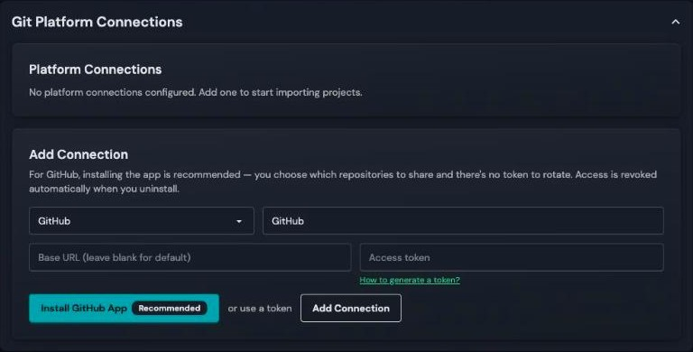
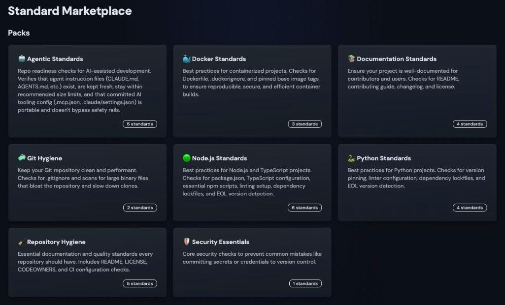
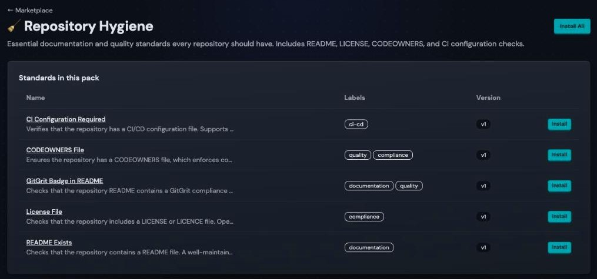
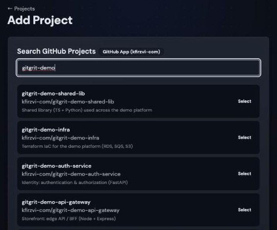
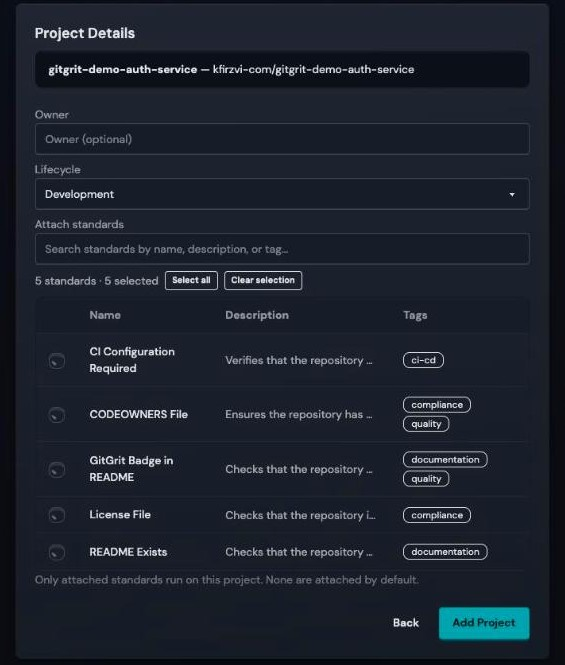
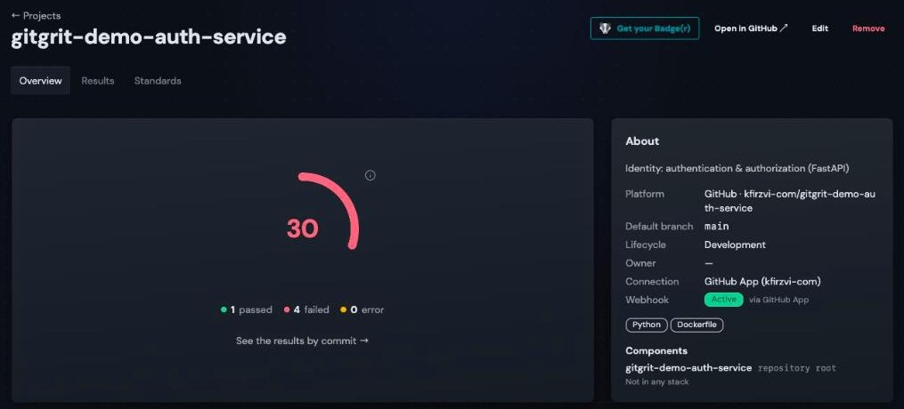
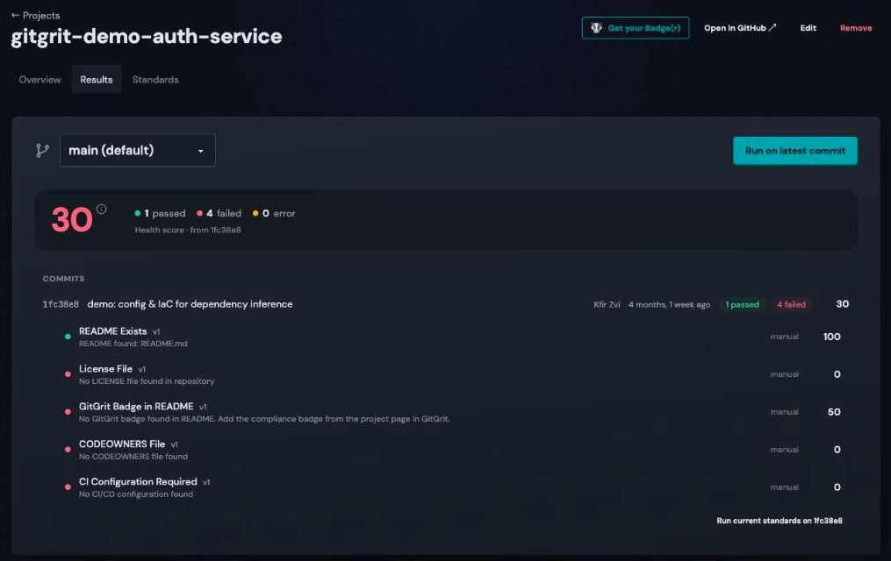

# Quick Start

From sign-in to your first health score in about 10 minutes.

**You'll need:** a GitHub organization (or GitLab group) where you can install apps, and one or two repositories to try it on.

## 1. Request access

Go to [app.gitgrit.dev](https://app.gitgrit.dev) and sign in with Google, GitHub, GitLab, or an email and password.

{ .gg-shot .gg-shot--narrow loading=lazy }

Tell us a little about you and your team, then **Request access**. Signing up with email? Confirm your address from the email we send first.

{ .gg-shot .gg-shot--narrow loading=lazy }

We'll email you as soon as you're in. Sign in the same way you just did, and you land in your company's workspace.

## 2. Connect your git platform

On the empty dashboard, click **Connect git platform**.

{ .gg-shot loading=lazy }

Click **Install GitHub App**.

{ .gg-shot loading=lazy }

GitHub asks where to install GitGrit:

1. Pick your organization.
2. Choose **Only select repositories** and pick the repos you want to try. You can add more later from GitHub.
3. Click **Install**. You're sent back to GitGrit.

!!! tip "No admin rights on the org?"
    GitHub sends the install to an org owner for approval. Once they approve, click **Install GitHub App** again.

??? note "GitLab, or using a token instead"
    Pick **GitLab** (or GitHub) in the same form, paste a personal access token, and click **Add Connection**. **How to generate a token?** lists the permissions it needs.

!!! tip "Prefer the terminal?"
    Once GitHub is connected, steps 3 to 5 are three commands. Run them inside a clone of your repository:

    ```sh
    gitgrit marketplace install repo-hygiene
    gitgrit project add --all-standards
    gitgrit health
    ```

    See [Command Line](cli.md) to install the CLI and sign in.

## 3. Install standards

A standard is a check that runs on every commit, like "has a README" or "has CI configured". Start from a ready-made pack: open **Marketplace**.

{ .gg-shot loading=lazy }

**Repository Hygiene** is a good first pack: it works on any repo, whatever the language. Open it and click **Install All**.

{ .gg-shot loading=lazy }

## 4. Add your repositories

Go to **Projects** → **Add Project**, pick your connection, and click **Select** next to a repository.

{ .gg-shot loading=lazy }

Under **Attach standards**, click **Select all**, then **Add Project**.

{ .gg-shot loading=lazy }

!!! warning "Attach at least one standard"
    Only attached standards run on a project, and none are attached by default. You can attach more later from the project's **Standards** tab.

Repeat for each repository you want to try.

## 5. See your score

The standards start running as soon as the project is added. Within a minute the project page shows its health score:

{ .gg-shot loading=lazy }

Open **Results** to see what passed, what failed, and why:

{ .gg-shot loading=lazy }

From now on every push re-runs the standards automatically. To run them on demand, click **Run on latest commit**.

## 6. Use it from your terminal

The `gitgrit` CLI does all of the above from your terminal, scripts, and CI:

```sh
curl -fsSL https://gitgrit.dev/install.sh | sh
gitgrit auth login
cd ~/src/your-repo
gitgrit health
```

To fail a CI build when standards fail, run `gitgrit check --wait` with a workspace token. [Command Line](cli.md) has every command and the CI setup.

## What's next?

- [Command Line](cli.md): every command, and CI
- [Workspaces & Members](workspaces.md): invite your team and set roles
- [Writing Standards](standards.md): encode your own team's rules
- [Standard Marketplace](../features/marketplace.md): Docker, Node.js, Python, security, and more
- [Compliance Badges](../features/badges.md): show the score in your README
