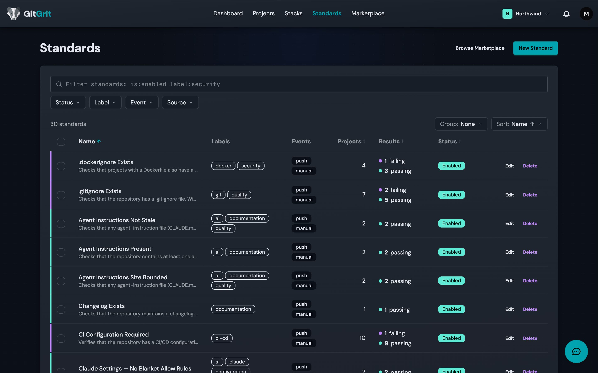
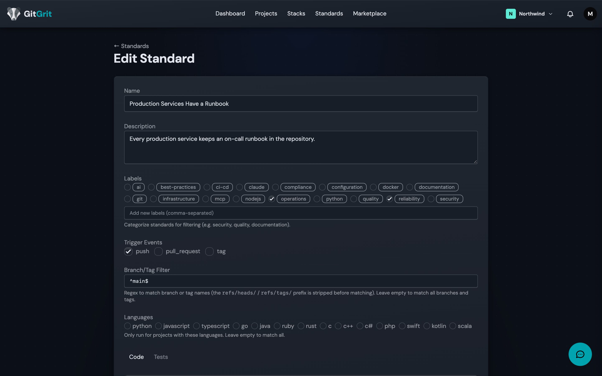

# Writing Standards

Standards are Python functions that evaluate a repository and return a compliance result. Start from the [marketplace](../features/marketplace.md), or write your own: **Standards** → **New Standard**.

**Standards** lists the workspace's standards with their labels, events, how many projects each is attached to, how many of those pass and fail, and whether it's enabled:

{ .gg-shot loading=lazy }

<video class="gg-video" controls muted playsinline preload="metadata" poster="../../images/app/standard-detail.jpg" aria-label="A team standard: its code, version history and editor">
  <source src="../../videos/standard.webm" type="video/webm">
</video>

## Structure

Every standard must define an `evaluate` function that receives a `project` object:

```python
def evaluate(project):
    files = project.list_files()

    if "README.md" in files:
        return {
            "passed": True,
            "score": 100,
            "message": "README found",
            "details": {},
        }

    return {
        "passed": False,
        "score": 0,
        "message": "No README found",
        "details": {},
    }
```

## Logging

Add a `log` parameter and write to the run's log. It shows on the run's page, next to the result, so a failure can be explained later:

```python
def evaluate(project, log):
    files = project.list_files()
    log.info(f"{len(files)} files")
    if "docs/runbook.md" not in files:
        log.warn("no runbook under docs/")
    ...
```

`log` has `info`, `warn`, `error` and `debug`. GitGrit adds its own lines too: when the run started, what `evaluate` returned, and how long it took.

## Asking an AI model

Add an `llm` parameter, and a model judges what a file check can't: *"the README explains local setup"*. See [AI Standards & Budgets](../features/ai.md#writing-an-llm-standard).

## Return value

The `evaluate` function must return a dictionary with:

| Key | Type | Description |
|-----|------|-------------|
| `passed` | `bool` | Whether the standard passed |
| `score` | `int` | Score from 0 to 100 |
| `message` | `str` | Human-readable result summary |
| `details` | `dict` | Additional data (shown in execution details) |

## Available API

The `project` object provides methods to query the repository. See the full [ProjectContext API](../api/project-context.md) reference.

## Criteria filters

Standards can be filtered to run only on specific events, branches, or languages:

- **Events** — `push`, `pull_request`, `tag` (an upload to an [artifact project](artifact-projects.md) is a `push`)
- **Branch filter** — regex matched against the branch or tag the event is for: the pushed branch, or a pull request's target branch (e.g., `^main$`; the `refs/heads/` / `refs/tags/` prefix is stripped first)
- **Languages** — only run if the project uses specific languages

Leaving a filter empty means "match all."

## Test cases

Each standard can have test cases that validate the logic with mock data. Test cases define:

- **Input** — mock data for `ProjectContext` methods (e.g., `list_files`, `get_file_content`)
- **Expected** — expected `passed` and `score` values

In the editor, the **Tests** tab lists them: give each an input (JSON for the `ProjectContext` methods) and the expected output, and run them to see **Matches expected** or **Mismatch** with the full result, before you save.

{ .gg-shot loading=lazy }

## Drafts, enabling and disabling

- A **draft** never runs. Save work in progress as a draft and attach it later.
- **Disable** a standard to stop it running everywhere it's attached, without detaching it. Its last results stay.
- **Delete** archives it: it leaves every project, but its past results keep the code they ran.

Every save is a new [version](../features/versioning.md), and each run records the version it ran.

## From the terminal

```sh
gitgrit standard list
gitgrit standard create --name "Has a runbook" --file runbook.py --event push --label operations
gitgrit standard test runbook.py --mock mock.json      # run it on mock data, without saving
gitgrit standard edit <id> --file runbook.py --summary "Clearer message"
gitgrit standard disable <id>
gitgrit standard view <id> --code > runbook.py         # pull the code back down
```

Set its Branch/Tag Filter in the app or the [API](../api/rest.md).
