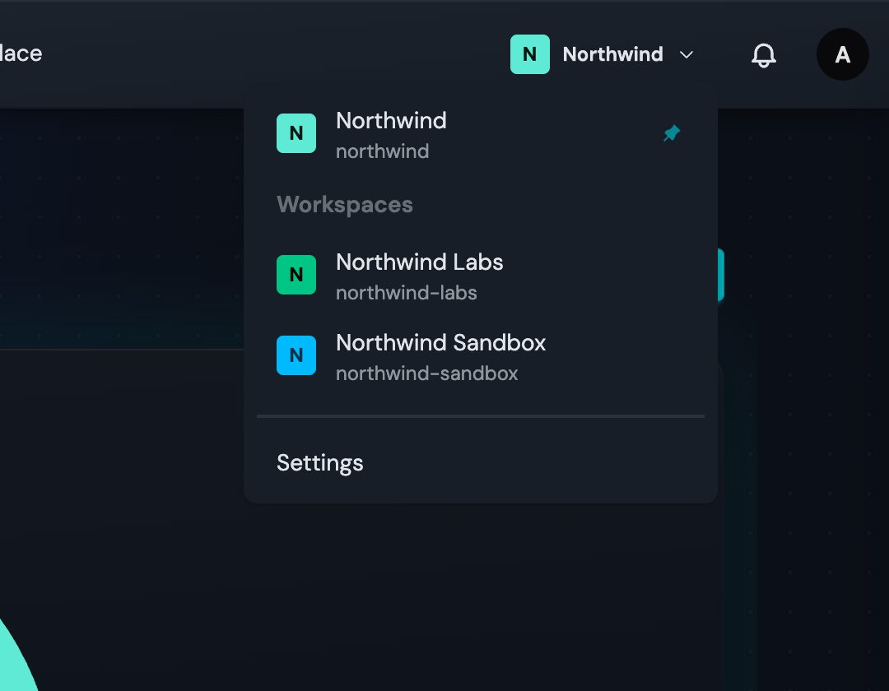
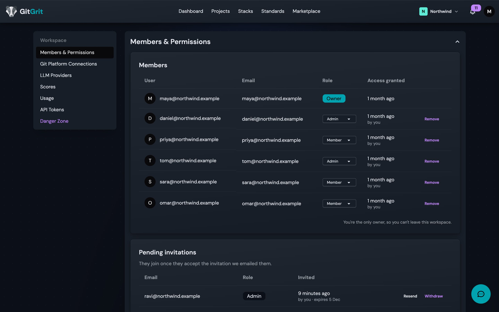

# Workspaces & Members

A workspace holds everything your team shares: platform connections, projects, stacks, standards and AI providers. Each person belongs to one or more workspaces, with a role in each.

Workspaces are created by the GitGrit team (on a self-hosted install, by a [superuser](../self-hosting/operations.md#managing-access)), usually when they approve the first person from your company. That person becomes its owner.

## Switching workspaces

The workspace picker, top right, lists every workspace you belong to. Type to narrow it down when you have many. Hover a row and click its pin to keep it at the top: pinned workspaces lead the list, then the rest. Your pins are yours alone; pinning never changes who can open a workspace.

{ .gg-shot loading=lazy }

## Your time zone

The messages GitGrit sends you write their times in your own time zone. GitGrit asks for it once, suggesting your device's zone; change it any time on your **profile** (click your avatar, top right), under **Time zone**. Until you pick one, times read in UTC.

A [schedule](../features/schedules.md) has its own time zone, which starts as yours.

## Roles

| | Owner | Admin | Member |
|---|:-:|:-:|:-:|
| Use projects, stacks and standards | ✓ | ✓ | ✓ |
| Manage connections, AI providers and API tokens | ✓ | ✓ | |
| Invite and remove members and admins | ✓ | ✓ | |
| Make someone an owner, change or remove an owner | ✓ | | |
| Delete the workspace | ✓ | | |

A workspace always has at least one owner. Its last owner can't step down, be removed or leave; make someone else an owner first.

## Managing members

Everything is under **Workspace Settings → Members & Permissions**:

{ .gg-shot loading=lazy }

- **Invite** anyone by email, with a role. We email them a link; they join once they accept it. Nobody is added to a workspace without accepting. Someone new to GitGrit creates their account from the link, and the invitation lets them straight in, with no access request. Someone who already has an account also sees the invitation in the app. Invitations last two weeks; pending ones are listed under the members, where you can resend or withdraw them.
- **Change a role** from the dropdown in their row. GitGrit asks you to confirm and explains what the new role can do.
- **Remove** someone, or **Leave** the workspace yourself.

Each row shows who gave the person their current role, and when.

## Deleting a workspace

Owners find it under **Workspace Settings → Danger Zone**. To confirm, you type the workspace's name exactly. Deleting is permanent: every project, standard, run, connection and member goes with it, and GitGrit removes the webhooks it added to your repositories. A GitHub App installation stays on your GitHub organisation; uninstall it there if you no longer want it.
